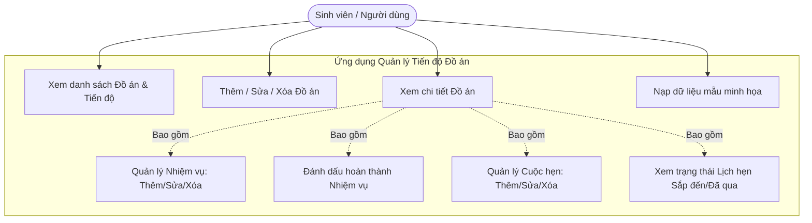
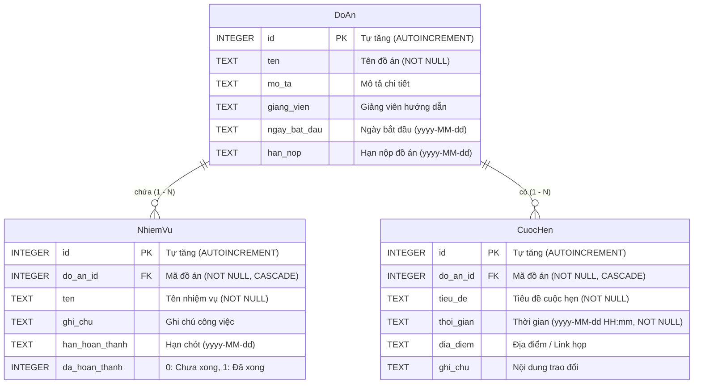
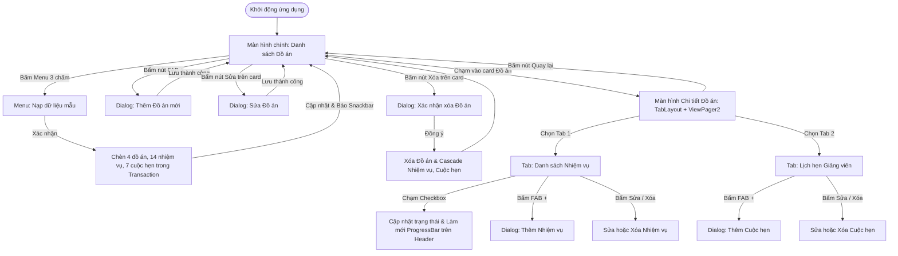

# BÁO CÁO BÀI TẬP LỚN LẬP TRÌNH THIẾT BỊ DI ĐỘNG
## ĐỀ TÀI: ỨNG DỤNG THEO DÕI TIẾN ĐỘ ĐỒ ÁN VÀ LỊCH HẸN GIẢNG VIÊN (ANDROID)

---

* **Học phần:** Lập trình Thiết bị Di động (LTTBDD)
* **Nền tảng:** Android (Java, SQLite thuần, ViewBinding, Material Components)
* **Package:** `com.example.app`
* **Cơ sở dữ liệu:** `tiendo.db` (SQLite)

---

## MỤC LỤC
1. [Giới thiệu đề tài](#1-giới-thiệu-đề-tài)
2. [Phân tích yêu cầu](#2-phân-tích-yêu-cầu)
3. [Thiết kế Cơ sở Dữ liệu (CSDL)](#3-thiết-kế-cơ-sở-dữ-liệu-csdl)
4. [Thiết kế Giao diện Người dùng (UI/UX)](#4-thiết-kế-giao-diện-người-dùng-uiux)
5. [Thiết kế Kiến trúc và Kỹ thuật Lập trình](#5-thiết-kế-kiến-trúc-và-kỹ-thuật-lập-trình)
6. [Kiểm thử và Đánh giá](#6-kiểm-thử-và-đánh-giá)
7. [Kết quả đạt được, Hạn chế và Hướng phát triển](#7-kết-quả-đạt-được-hạn-chế-và-hướng-phát-triển)
8. [Phụ lục](#8-phụ-lục)

---

## 1. GIỚI THIỆU ĐỀ TÀI

### 1.1. Đặt vấn đề và bài toán thực tế
Trong quá trình học tập tại bậc đại học, sinh viên công nghệ thông tin và các ngành kỹ thuật thường xuyên phải thực hiện đồng thời nhiều loại đồ án khác nhau: Đồ án môn học, Thực tập chuyên ngành, Đề án khởi nghiệp, và Đồ án tốt nghiệp (Khóa luận tốt nghiệp). Mỗi đồ án kéo dài từ vài tuần đến hàng tháng, bao gồm khối lượng công việc lớn được chia thành nhiều giai đoạn, nhiều hạn chót (deadline) trung gian, cùng các buổi gặp gỡ, báo cáo định kỳ với Giảng viên hướng dẫn (GVHD).

Thực tế sinh viên hay gặp các khó khăn:
* Không nắm bắt được tiến độ tổng quát: Dễ bị "dồn ứ" khối lượng công việc vào sát ngày nộp.
* Bỏ quên các đầu việc nhỏ hoặc nhầm lẫn hạn hoàn thành giữa các môn học.
* Quên hoặc nhầm lẫn lịch hẹn, địa điểm gặp giảng viên (văn phòng bộ môn, phòng lab, phòng họp trực tuyến Google Meet/Zoom).
* Phụ thuộc vào các ứng dụng ghi chú rời rạc, không gắn liền trực tiếp giữa đồ án – nhiệm vụ – lịch hẹn.

### 1.2. Mục tiêu và đối tượng sử dụng
* **Đối tượng sử dụng chính:** Sinh viên đại học/cao đẳng cần công cụ cá nhân trực quan trên điện thoại để quản lý tiến độ học tập.
* **Mục tiêu của ứng dụng:** Xây dựng một ứng dụng Android hoàn chỉnh, hoạt động độc lập (offline-first), lưu trữ an toàn bằng SQLite thuần, cung cấp giao diện Material hiện đại giúp sinh viên dễ dàng theo dõi toàn bộ đồ án, nhiệm vụ và lịch hẹn một cách khoa học.

### 1.3. Phạm vi chức năng
* **Quản lý Đồ án (Projects):** Thêm, sửa, xóa thông tin đồ án, người hướng dẫn, thời gian bắt đầu và hạn nộp; hiển thị tiến độ hoàn thành tự động tính toán dạng tỷ lệ phần trăm (%).
* **Quản lý Nhiệm vụ (Tasks):** Chia nhỏ đồ án thành các đầu mục công việc, đặt hạn hoàn thành, đánh dấu nhanh trạng thái hoàn thành trực tiếp bằng checkbox.
* **Quản lý Cuộc hẹn (Appointments):** Đặt lịch trao đổi với giảng viên kèm mốc thời gian (ngày, giờ), địa điểm và nội dung cần trao đổi; tự động phân loại cuộc hẹn "Sắp diễn ra" và "Đã qua".
* **Bộ dữ liệu mẫu (Sample Data):** Tích hợp chức năng nạp dữ liệu mẫu thực tế chỉ với một thao tác, hỗ trợ minh họa và nghiệm thu sản phẩm thuận tiện.

---

## 2. PHÂN TÍCH YÊU CẦU

### 2.1. Yêu cầu chức năng
1. **Quản trị Đồ án:**
   * Xem danh sách đồ án kèm thanh tiến độ trực quan, số đầu việc đã xong/tổng số.
   * Thêm đồ án mới với ràng buộc: Hạn nộp phải sau hoặc bằng ngày bắt đầu.
   * Chỉnh sửa thông tin đồ án đã có.
   * Xóa đồ án kèm cảnh báo xóa xếp tầng (cascade) toàn bộ nhiệm vụ và cuộc hẹn trực thuộc.
2. **Quản trị Nhiệm vụ:**
   * Xem danh sách nhiệm vụ của từng đồ án, tự động phân nhóm/sắp xếp: việc chưa hoàn thành lên trước, việc đã hoàn thành xuống dưới.
   * Thêm nhiệm vụ với ràng buộc: Hạn hoàn thành của nhiệm vụ không được vượt quá hạn nộp của đồ án.
   * Chỉnh sửa và xóa từng nhiệm vụ.
   * Chạm vào Checkbox để đảo trạng thái (hoàn thành / chưa xong); thanh tiến độ đồ án cập nhật tức thì.
3. **Quản trị Cuộc hẹn:**
   * Xem danh sách cuộc hẹn sắp xếp theo thứ tự thời gian tăng dần.
   * Hiển thị trực quan nhãn trạng thái (Badge): màu xanh lá *"Sắp diễn ra"* đối với cuộc hẹn trong tương lai, màu xám *"Đã qua"* đối với cuộc hẹn trong quá khứ so với thời điểm hiện tại.
   * Thêm, sửa, xóa cuộc hẹn với bộ chọn ngày (DatePicker) và bộ chọn giờ (TimePicker).
4. **Nạp dữ liệu mẫu:**
   * Menu nạp dữ liệu mẫu từ thanh Toolbar.
   * Hộp thoại xác nhận an toàn: Nếu CSDL đang có dữ liệu, hỏi người dùng muốn thêm tiếp hay hủy bỏ; không tự ý xóa hay ghi đè dữ liệu người dùng.

### 2.2. Yêu cầu phi chức năng
* **Độ tương thích:** Hỗ trợ từ Android 7.0 (API 24 - Nougat) đến Android 15/16 (API 35-37).
* **Hiệu năng & Bộ nhớ:** Khởi động nhanh dưới 1 giây, cuộn danh sách mượt mà (60–120 fps) nhờ cơ chế tái sử dụng ViewHolder của RecyclerView và so sánh vi sai DiffUtil.
* **Độ tin cậy & Toàn vẹn:** Dữ liệu không bị mất hoặc sai lệch khi xoay màn hình điện thoại (Configuration Change), thao tác CSDL hàng loạt thực hiện trong Transaction để đảm bảo tính nguyên tử.
* **Trải nghiệm người dùng (UX):** Thiết kế theo hướng dẫn Material Design 3, màu sắc tương phản rõ ràng, hỗ trợ đầy đủ Chế độ Tối (Dark Theme).

### 2.3. Sơ đồ Use Case tổng quát



---

## 3. THIẾT KẾ CƠ SỞ DỮ LIỆU (CSDL)

### 3.1. Sơ đồ Thực thể Mối quan hệ (ERD)



### 3.2. Mô tả chi tiết các bảng CSDL

#### Bảng 1: `DoAn` (Lưu thông tin đồ án)
* `id` (INTEGER, Primary Key, Auto Increment): Mã định danh duy nhất của đồ án.
* `ten` (TEXT, NOT NULL): Tên đồ án hoặc đề tài nghiên cứu.
* `mo_ta` (TEXT, Nullable): Tóm tắt mục tiêu, nội dung đồ án.
* `giang_vien` (TEXT, Nullable): Họ và tên, học hàm học vị của GVHD.
* `ngay_bat_dau` (TEXT, Nullable): Ngày khởi động làm đồ án theo định dạng chuẩn ISO-8601 (`yyyy-MM-dd`).
* `han_nop` (TEXT, Nullable): Ngày phải nộp đồ án (`yyyy-MM-dd`).

#### Bảng 2: `NhiemVu` (Lưu các đầu việc thuộc đồ án)
* `id` (INTEGER, Primary Key, Auto Increment): Mã nhiệm vụ.
* `do_an_id` (INTEGER, NOT NULL, Foreign Key): Khóa ngoại liên kết tới `DoAn(id)` với thuộc tính `ON DELETE CASCADE`.
* `ten` (TEXT, NOT NULL): Tên đầu việc cần làm.
* `ghi_chu` (TEXT, Nullable): Hướng dẫn, lưu ý khi thực hiện.
* `han_hoan_thanh` (TEXT, Nullable): Hạn chót của việc (`yyyy-MM-dd`).
* `da_hoan_thanh` (INTEGER, NOT NULL, DEFAULT 0): Cờ trạng thái (0: Chưa xong, 1: Đã hoàn thành).

#### Bảng 3: `CuocHen` (Lưu lịch hẹn gặp GVHD)
* `id` (INTEGER, Primary Key, Auto Increment): Mã cuộc hẹn.
* `do_an_id` (INTEGER, NOT NULL, Foreign Key): Khóa ngoại liên kết tới `DoAn(id)` với thuộc tính `ON DELETE CASCADE`.
* `tieu_de` (TEXT, NOT NULL): Nội dung hoặc chủ đề buổi hẹn.
* `thoi_gian` (TEXT, NOT NULL): Thời điểm hẹn đầy đủ ngày và giờ (`yyyy-MM-dd HH:mm`).
* `dia_diem` (TEXT, Nullable): Phòng học, văn phòng khoa, phòng lab hoặc đường dẫn phòng họp trực tuyến.
* `ghi_chu` (TEXT, Nullable): Nội dung cần chuẩn bị hoặc kết quả trao đổi.

---

### 3.3. Giải thích các quyết định thiết kế CSDL

#### 1. Lý do tách thành 3 bảng riêng biệt
Theo nguyên lý chuẩn hóa cơ sở dữ liệu (đạt dạng chuẩn 3NF):
* Một đồ án có thể có không giới hạn số lượng nhiệm vụ và cuộc hẹn.
* Các thuộc tính của `NhiemVu` (như `han_hoan_thanh`, `da_hoan_thanh`) chỉ phụ thuộc vào nhiệm vụ cụ thể, không phụ thuộc trực tiếp vào toàn bộ đồ án.
* Việc tách riêng giúp tránh dư thừa dữ liệu (data redundancy), loại bỏ hoàn toàn các bất thường khi cập nhật (update anomalies), chèn (insert anomalies) hoặc xóa (delete anomalies).

#### 2. Khóa ngoại và ràng buộc `ON DELETE CASCADE`
* **Vấn đề thực tế:** Khi một sinh viên hủy bỏ hoặc xóa một đồ án, tất cả nhiệm vụ và cuộc hẹn của đồ án đó sẽ trở thành "dữ liệu mồ côi" (orphaned records) nếu không được dọn dẹp, gây lãng phí dung lượng lưu trữ và sai lệch thống kê.
* **Giải pháp:** Thiết lập khóa ngoại `REFERENCES DoAn(id) ON DELETE CASCADE` và bật ràng buộc này trong `DatabaseHelper.onConfigure(SQLiteDatabase db)` bằng `db.setForeignKeyConstraintsEnabled(true);`. Khi xóa một dòng trong bảng `DoAn`, hệ thống SQLite tự động xóa sạch toàn bộ các dòng liên quan trong `NhiemVu` và `CuocHen` ở cấp độ CSDL, không cần phải viết thủ công nhiều câu lệnh xóa phức tạp ở tầng ứng dụng.

#### 3. Vì sao lưu trữ ngày giờ dạng `TEXT` (`yyyy-MM-dd` và `yyyy-MM-dd HH:mm`)?
SQLite không có kiểu dữ liệu `DATE` hay `DATETIME` riêng mà sử dụng cơ chế Dynamic Typing với 5 kiểu cơ bản (NULL, INTEGER, REAL, TEXT, BLOB).
Định dạng chuỗi chuẩn ISO-8601 được lựa chọn vì 3 lý do kỹ thuật:
1. **Khả năng so sánh và sắp xếp tự nhiên:** Định dạng chuỗi `yyyy-MM-dd` có thứ tự sắp xếp từ lớn đến nhỏ (năm $\rightarrow$ tháng $\rightarrow$ ngày). Do đó, phép so sánh từ vựng (lexicographical comparison) thông thường trùng khớp hoàn toàn với thứ tự thời gian (`"2026-03-01" < "2026-06-30"`). Ta có thể dùng trực tiếp toán tử `<`, `>`, `=` và `ORDER BY thoi_gian ASC` trong SQL mà không cần chuyển đổi.
2. **Dễ đọc, gỡ lỗi và đồng bộ:** Dữ liệu khi xem bằng DB Browser for SQLite hoặc xuất ra JSON hoàn toàn trực quan, không bị phụ thuộc vào định dạng epoch millisecond khó đọc đối với con người.
3. **Tương thích hoàn hảo với các hàm thời gian của SQLite:** SQLite hỗ trợ sẵn các hàm `date()`, `time()`, `datetime()`, `strftime()` thao tác trực tiếp trên chuỗi định dạng ISO này.

#### 4. Vì sao tính tiến độ bằng truy vấn thay vì lưu cứng cột `tien_do` trong bảng `DoAn`?
Nếu thêm cột `tien_do` (hoặc `phan_tram`) vào bảng `DoAn`:
* Mỗi khi thêm một nhiệm vụ, xóa một nhiệm vụ, hoặc người dùng chạm Checkbox để đổi trạng thái một nhiệm vụ, ta bắt buộc phải nhớ cập nhật lại bảng `DoAn`.
* Nếu có bất kỳ lỗi logic nào xảy ra khiến việc cập nhật bảng `DoAn` thất bại, dữ liệu giữa bảng `DoAn` và bảng `NhiemVu` sẽ bị **mất đồng bộ (inconsistent state)**.
* **Giải pháp tối ưu:** Tiến độ là **dữ liệu phái sinh (derived data)**. Ứng dụng sử dụng câu truy vấn `LEFT JOIN` kết hợp hàm gom nhóm `COUNT` và `SUM(CASE WHEN da_hoan_thanh = 1 THEN 1 ELSE 0 END)` để tính toán động tại thời điểm truy vấn. Bằng cách này, tiến độ luôn phản ánh đúng 100% sự thật trạng thái của các nhiệm vụ trong CSDL mà không có nguy cơ lệch pha dữ liệu.

#### 5. Vì sao chọn SQLite thuần (`SQLiteOpenHelper`) thay vì thư viện Room?
Đồ án lựa chọn sử dụng SQLite thuần theo đúng định hướng môn học:
1. **Nắm vững bản chất cốt lõi của Android OS:** Giúp sinh viên hiểu sâu sắc về kiến trúc CSDL nhúng, vòng đời của `SQLiteOpenHelper` (`onCreate`, `onUpgrade`, `onConfigure`), cách quản lý con trỏ `Cursor`, `ContentValues` và cú pháp SQL tiêu chuẩn mà không bị che khuất bởi các lớp trừu tượng (abstraction layer).
2. **Không làm phình to dung lượng ứng dụng:** Thư viện Room yêu cầu Annotation Processor (KSP/kapt) và nhiều thư viện bổ trợ runtime, làm tăng thời gian build và kích thước file APK. Sử dụng SQLite thuần giữ cho dự án nhẹ, độc lập và dễ bảo trì trên mọi môi trường biên dịch.

---

## 4. THIẾT KẾ GIAO DIỆN NGƯỜI DÙNG (UI/UX)

### 4.1. Danh sách màn hình và các thành phần giao diện
1. **Màn hình chính (`MainActivity` - `activity_main.xml`):**
   * Thanh AppBar: Hiển thị Toolbar với tiêu đề *"Theo dõi đồ án"* và nút menu 3 chấm (overflow menu) nạp dữ liệu mẫu.
   * `RecyclerView` (`rvDoAn`): Hiển thị danh sách các đồ án theo chiều dọc. Mỗi item đồ án hiển thị tên, giảng viên hướng dẫn, thời hạn, thanh ProgressBar và nhãn phần trăm tiến độ kèm số việc đã hoàn thành/tổng số việc.
   * `layoutEmpty`: Giao diện trạng thái rỗng (Empty State) với biểu tượng đồ họa và thông điệp hướng dẫn thân thiện khi CSDL chưa có đồ án.
   * `FloatingActionButton` (`fabAddDoAn`): Nút tròn nổi ở góc dưới bên phải để kích hoạt hộp thoại thêm đồ án mới.
2. **Hộp thoại Thêm/Sửa Đồ án (`AddEditDoAnDialogFragment` - `dialog_add_edit_do_an.xml`):**
   * Chứa các ô nhập liệu `TextInputLayout` / `TextInputEditText` cho tên đồ án, giảng viên, mô tả.
   * Hai ô chọn ngày bắt đầu và hạn nộp được gắn `MaterialDatePicker` chống lỗi nhập sai định dạng.
   * Nút Lưu kiểm tra tính hợp lệ trước khi đóng dialog.
3. **Màn hình Chi tiết Đồ án (`DoAnDetailActivity` - `activity_do_an_detail.xml`):**
   * Toolbar có nút quay lại (Back arrow).
   * Khối tổng quan phía trên (Header card): Tên đồ án, GVHD, ngày bắt đầu $\rightarrow$ hạn nộp, thanh tiến độ tổng thể cập nhật theo thời gian thực.
   * Thanh điều hướng tab `TabLayout` kết hợp `ViewPager2` chia làm 2 tab con:
     * **Tab 1: Nhiệm vụ (`NhiemVuFragment` - `fragment_nhiem_vu.xml`):** Danh sách việc, checkbox đánh dấu nhanh, nút FAB thêm nhiệm vụ.
     * **Tab 2: Cuộc hẹn (`CuocHenFragment` - `fragment_cuoc_hen.xml`):** Danh sách lịch hẹn, badge trạng thái màu sắc, nút FAB thêm lịch hẹn.
4. **Hộp thoại Thêm/Sửa Nhiệm vụ (`AddEditNhiemVuDialogFragment`):**
   * Nhập tên việc, ghi chú, chọn ngày hoàn thành (`MaterialDatePicker`). Ràng buộc ngày không được vượt quá hạn nộp đồ án.
5. **Hộp thoại Thêm/Sửa Cuộc hẹn (`AddEditCuocHenDialogFragment`):**
   * Nhập tiêu đề, địa điểm, ghi chú. Chọn ngày và chọn giờ kết hợp giữa `MaterialDatePicker` và `TimePickerDialog`.
6. **Hộp thoại Xác nhận Xóa (`ConfirmDeleteDialogFragment`):**
   * Hộp thoại cảnh báo đồng nhất cho cả 3 đối tượng (Đồ án, Nhiệm vụ, Cuộc hẹn) sử dụng `Fragment Result API` để trả kết quả về màn hình gọi.

### 4.2. Luồng điều hướng (Navigation Flow)



### 4.3. Lý do lựa chọn các thành phần giao diện

#### 1. Material Components (MDC-Android)
* Đảm bảo tính nhất quán cao về mặt thị giác theo tiêu chuẩn thiết kế của Google.
* Sử dụng `MaterialCardView` tạo độ nổi (elevation) và góc bo tròn hiện đại; `TextInputLayout` cung cấp hiệu ứng nhãn nổi (floating label) và hiển thị thông báo lỗi (helper text/error) mượt mà; `FloatingActionButton` định vị rõ ràng hành động chính của màn hình.

#### 2. `RecyclerView`
* Khác với `ListView` thế hệ cũ, `RecyclerView` bắt buộc sử dụng mẫu thiết kế **ViewHolder Pattern** nhằm tái sử dụng các View đã cuộn khỏi màn hình, giúp giảm thiểu tối đa số lần gọi `findViewById` và cấp phát bộ nhớ.
* Hỗ trợ diễn hoạt (animations) thêm, sửa, xóa phần tử mượt mà và khả năng tùy biến LayoutManager linh hoạt.

#### 3. `TabLayout` kết hợp `ViewPager2`
* Trong màn hình chi tiết đồ án, việc hiển thị đồng thời cả Nhiệm vụ và Cuộc hẹn trên cùng một danh sách cuộn dài sẽ gây rối mắt cho sinh viên.
* Sử dụng `ViewPager2` (xây dựng trên nền RecyclerView) kết hợp `TabLayout` cho phép người dùng chuyển đổi qua lại giữa hai nhóm dữ liệu bằng cách chạm vào tiêu đề tab hoặc vuốt ngang màn hình một cách tự nhiên. Mỗi tab được quản lý bởi một `Fragment` riêng biệt, giúp phân tách logic giao diện rõ ràng.

#### 4. `DialogFragment`
* Thay vì mở một `Activity` mới toàn màn hình chỉ để nhập vài trường thông tin, ứng dụng sử dụng `DialogFragment`.
* Điều này giúp người dùng giữ được ngữ cảnh của màn hình hiện tại, thao tác nhanh gọn. Đồng thời, `DialogFragment` tự động quản lý vòng đời và khôi phục trạng thái nhập liệu khi xoay màn hình điện thoại mà `AlertDialog` thông thường không làm được.

#### 5. `ViewBinding`
* `ViewBinding` tự động tạo ra một lớp Binding tương ứng cho từng tệp layout XML, chứa các tham chiếu trực tiếp, an toàn kiểu (Type-safe) và an toàn rỗng (Null-safe) đến tất cả các View có đặt `android:id`.
* Loại bỏ hoàn toàn nguy cơ ứng dụng bị sập do `NullPointerException` (khi gõ nhầm ID của View) hoặc `ClassCastException` (khi ép sai kiểu View), vượt trội hoàn toàn so với cú pháp `findViewById` truyền thống.

---

## 5. THIẾT KẾ KIẾN TRÚC VÀ KỸ THUẬT LẬP TRÌNH

### 5.1. Cấu trúc Package của dự án

```
app/src/main/java/com/example/app/
├── MainActivity.java               // Màn hình khởi đầu: Danh sách đồ án, menu nạp dữ liệu mẫu
├── adapter/                        // Các Adapter hiển thị danh sách cho RecyclerView
│   ├── DoAnAdapter.java            // ListAdapter hiển thị danh sách đồ án kèm tiến độ
│   ├── NhiemVuAdapter.java         // ListAdapter hiển thị danh sách nhiệm vụ & xử lý checkbox
│   └── CuocHenAdapter.java         // ListAdapter hiển thị danh sách cuộc hẹn & gắn badge
├── db/                             // Tầng Cơ sở dữ liệu
│   ├── DatabaseHelper.java         // Quản lý tạo bảng, nâng cấp CSDL và bật Foreign Keys
│   ├── DoAnDao.java                // Truy vấn CSDL cho bảng DoAn & tính toán tiến độ
│   ├── NhiemVuDao.java             // Truy vấn CRUD & cập nhật nhanh trạng thái cho NhiemVu
│   └── CuocHenDao.java             // Truy vấn CRUD & sắp xếp thời gian cho CuocHen
├── model/                          // Lớp mô hình đối tượng (POJO / DTO)
│   ├── DoAn.java                   // Thực thể Đồ án
│   ├── NhiemVu.java                // Thực thể Nhiệm vụ
│   ├── CuocHen.java                // Thực thể Cuộc hẹn
│   ├── TienDoInfo.java             // Chứa số việc hoàn thành, tổng số việc, phần trăm
│   └── DoAnWithTienDo.java         // Đối tượng kết hợp Đồ án và Tiến độ hiển thị
├── ui/                             // Tầng Giao diện người dùng
│   ├── DoAnDetailActivity.java     // Màn hình chi tiết đồ án chứa ViewPager2
│   ├── NhiemVuFragment.java        // Fragment quản lý danh sách nhiệm vụ
│   ├── CuocHenFragment.java        // Fragment quản lý danh sách cuộc hẹn
│   ├── AddEditDoAnDialogFragment.java       // Hộp thoại thêm/sửa đồ án
│   ├── AddEditNhiemVuDialogFragment.java     // Hộp thoại thêm/sửa nhiệm vụ
│   ├── AddEditCuocHenDialogFragment.java    // Hộp thoại thêm/sửa cuộc hẹn
│   └── ConfirmDeleteDialogFragment.java     // Hộp thoại xác nhận xóa dùng chung
└── util/                           // Các tiện ích phụ trợ
    ├── DateUtils.java              // Xử lý chuyển đổi định dạng ngày giờ, UTC, kiểm tra hợp lệ
    └── SampleDataLoader.java       // Nạp bộ dữ liệu mẫu JSON vào CSDL an toàn trong Transaction
```

---

### 5.2. Các kỹ thuật lập trình then chốt (kèm đoạn mã trích dẫn)

#### 1. Mẫu thiết kế Singleton cho `DatabaseHelper`
Để đảm bảo toàn bộ ứng dụng chỉ sử dụng duy nhất một kết nối mở tới tệp `tiendo.db`, tránh tình trạng tranh chấp ghi (database lock) giữa nhiều luồng:

```java
// Trích từ app/src/main/java/com/example/app/db/DatabaseHelper.java (dòng 41 - 48)
private static DatabaseHelper instance;

public static synchronized DatabaseHelper getInstance(Context context) {
    if (instance == null) {
        instance = new DatabaseHelper(context.getApplicationContext());
    }
    return instance;
}
```
*Lý do:* Sử dụng `context.getApplicationContext()` ngăn ngừa việc rò rỉ bộ nhớ (Memory Leak) khi Activity bị hủy. Từ khóa `synchronized` đảm bảo an toàn đa luồng (Thread-safe).

#### 2. Kỹ thuật DAO và truy vấn tiến độ bằng `LEFT JOIN`
Hàm `getAllWithTienDo()` trong `DoAnDao` thực hiện gom nhóm và tính toán tiến độ ngay trong SQL mà không cần duyệt vòng lặp ở Java:

```java
// Trích từ app/src/main/java/com/example/app/db/DoAnDao.java (dòng 108 - 120)
String query = "SELECT "
        + "d." + DatabaseHelper.COLUMN_ID + " AS d_id, "
        + "d." + DatabaseHelper.COLUMN_DO_AN_TEN + " AS d_ten, "
        + "d." + DatabaseHelper.COLUMN_DO_AN_MO_TA + " AS d_mo_ta, "
        + "d." + DatabaseHelper.COLUMN_DO_AN_GIANG_VIEN + " AS d_giang_vien, "
        + "d." + DatabaseHelper.COLUMN_DO_AN_NGAY_BAT_DAU + " AS d_ngay_bat_dau, "
        + "d." + DatabaseHelper.COLUMN_DO_AN_HAN_NOP + " AS d_han_nop, "
        + "COUNT(n." + DatabaseHelper.COLUMN_ID + ") AS total_tasks, "
        + "COALESCE(SUM(CASE WHEN n." + DatabaseHelper.COLUMN_NHIEM_VU_DA_HOAN_THANH + " = 1 THEN 1 ELSE 0 END), 0) AS completed_tasks "
        + "FROM " + DatabaseHelper.TABLE_DO_AN + " d "
        + "LEFT JOIN " + DatabaseHelper.TABLE_NHIEM_VU + " n ON d." + DatabaseHelper.COLUMN_ID + " = n." + DatabaseHelper.COLUMN_NHIEM_VU_DO_AN_ID + " "
        + "GROUP BY d." + DatabaseHelper.COLUMN_ID + " "
        + "ORDER BY d." + DatabaseHelper.COLUMN_ID + " DESC";
```

#### 3. Sử dụng `ListAdapter` và `DiffUtil`
Thay vì kế thừa `RecyclerView.Adapter` và dùng hàm `notifyDataSetChanged()` gây vẽ lại toàn bộ danh sách, dự án sử dụng `ListAdapter` kết hợp thuật toán tính hiệu vi sai `DiffUtil`:

```java
// Trích từ app/src/main/java/com/example/app/adapter/NhiemVuAdapter.java (dòng 23 - 35)
public class NhiemVuAdapter extends ListAdapter<NhiemVu, NhiemVuAdapter.ViewHolder> {

    private static final DiffUtil.ItemCallback<NhiemVu> DIFF_CALLBACK = new DiffUtil.ItemCallback<NhiemVu>() {
        @Override
        public boolean areItemsTheSame(@NonNull NhiemVu oldItem, @NonNull NhiemVu newItem) {
            return oldItem.getId() == newItem.getId();
        }

        @Override
        public boolean areContentsTheSame(@NonNull NhiemVu oldItem, @NonNull NhiemVu newItem) {
            return oldItem.equals(newItem);
        }
    };
```
*Lý do:* `DiffUtil` tự động tính toán chính xác phần tử nào bị đổi, thêm, hay xóa để chỉ cập nhật đúng item đó kèm hiệu ứng mượt mà, giúp tăng hiệu năng hiển thị đáng kể.

#### 4. Giao tiếp an toàn giữa Dialog và Activity bằng Fragment Result API
Dự án sử dụng cơ chế hiện đại của Android Jetpack: `setFragmentResult` và `setFragmentResultListener` thay thế cho interface callback truyền thống (dễ bị văng ứng dụng khi Activity tái tạo):

```java
// Trích từ app/src/main/java/com/example/app/MainActivity.java (dòng 49 - 65)
getSupportFragmentManager().setFragmentResultListener(
        ConfirmDeleteDialogFragment.REQUEST_KEY_DELETE,
        this,
        (requestKey, bundle) -> {
            boolean confirmed = bundle.getBoolean(ConfirmDeleteDialogFragment.RESULT_KEY_CONFIRMED, false);
            if (confirmed) {
                long id = bundle.getLong(ConfirmDeleteDialogFragment.RESULT_KEY_ITEM_ID);
                int rows = doAnDao.delete((int) id);
                if (rows > 0) {
                    Toast.makeText(this, R.string.action_success, Toast.LENGTH_SHORT).show();
                    loadData();
                }
            }
        }
);
```

#### 5. Xử lý chuẩn múi giờ UTC khi tích hợp `MaterialDatePicker`
Thành phần `MaterialDatePicker` của Google luôn trả về giá trị thời gian epoch millisecond tại mốc **00:00:00 theo giờ chuẩn UTC**. Nếu dùng trực tiếp định dạng giờ địa phương (ví dụ GMT+7 của Việt Nam), ngày hiển thị có thể bị lệch lùi lại 1 ngày do độ lệch múi giờ (lỗi off-by-one day kinh điển trên Android). Lớp `DateUtils` xử lý triệt để vấn đề này:

```java
// Trích từ app/src/main/java/com/example/app/util/DateUtils.java (dòng 46 - 65)
public static synchronized String formatUtcDate(Long utcMillis) {
    if (utcMillis == null) return "";
    SimpleDateFormat sdf = new SimpleDateFormat(DATE_FORMAT, Locale.getDefault());
    sdf.setTimeZone(java.util.TimeZone.getTimeZone("UTC"));
    return sdf.format(new Date(utcMillis));
}

public static synchronized Long dateStringToUtcMillis(String dateStr) {
    if (dateStr == null || dateStr.trim().isEmpty()) return null;
    try {
        SimpleDateFormat sdf = new SimpleDateFormat(DATE_FORMAT, Locale.getDefault());
        sdf.setTimeZone(java.util.TimeZone.getTimeZone("UTC"));
        Date date = sdf.parse(dateStr);
        return date != null ? date.getTime() : null;
    } catch (ParseException e) {
        return null;
    }
}
```

#### 6. Nạp dữ liệu mẫu an toàn trong CSDL bằng Transaction
Toàn bộ thao tác đọc JSON và chèn dữ liệu mẫu được bao bọc trong Transaction. Nếu xảy ra bất kỳ lỗi ngoại lệ nào, lệnh `setTransactionSuccessful()` sẽ không được gọi và CSDL được khôi phục nguyên vẹn về trạng thái ban đầu:

```java
// Trích từ app/src/main/java/com/example/app/util/SampleDataLoader.java (dòng 58 - 65 & 142 - 149)
db.beginTransaction();
try {
    String jsonContent = readAssetFile(context, "du_lieu_mau.json");
    JSONObject root = new JSONObject(jsonContent);
    JSONArray doAnArray = root.getJSONArray("do_an");
    // ... Chèn DoAn, NhiemVu và CuocHen ...
    db.setTransactionSuccessful();
    return new ImportResult(true, insertedProjects, insertedTasks, insertedMeetings, null);
} catch (Exception e) {
    return new ImportResult(false, 0, 0, 0, e.getMessage());
} finally {
    db.endTransaction();
}
```

---

## 6. KIỂM THỬ VÀ ĐÁNH GIÁ

### 6.1. Danh sách Unit Test đã chạy thực tế (`LogicUnitTest`)
Các kiểm thử đơn vị độc lập chạy trên máy trạm (Host JVM) bằng lệnh Gradle đã vượt qua 100% (5/5 tests):

| Tên bài test | Mục đích kiểm thử | Kết quả thực tế |
| :--- | :--- | :---: |
| `testTienDoInfoCalculation` | Kiểm tra tính toán tỷ lệ % hoàn thành, xử lý phép chia cho 0 khi đồ án có 0 nhiệm vụ (trả về 0%, không bị sập). | **PASS** |
| `testDateUtilsValidation` | Kiểm tra tính hợp lệ của khoảng thời gian (Hạn nộp $\ge$ Ngày bắt đầu), kiểm tra định dạng ngày giờ và kiểm tra hàm xác định mốc thời gian đã qua hay chưa. | **PASS** |
| `testDoAnWithTienDoModel` | Kiểm tra hàm `equals` và tính toàn vẹn của DTO `DoAnWithTienDo` dùng cho `DiffUtil`. | **PASS** |
| `testUtcConversionFixedValueAndMultipleTimeZones` | Giả lập chạy trên nhiều múi giờ khác nhau (`Asia/Ho_Chi_Minh`, `America/Los_Angeles`, `UTC`), khẳng định không bị lệch ngày khi chuyển đổi UTC. | **PASS** |
| `testSampleDataIntegrity` | Kiểm tra cấu trúc tệp dữ liệu mẫu `du_lieu_mau.json`, xác minh đủ 4 đồ án, 14 nhiệm vụ, 7 cuộc hẹn, các mốc thời gian hợp lệ. | **PASS** |

### 6.2. Kiểm thử CSDL và Tích hợp trên thiết bị thật / máy ảo (`DatabaseTest`)
Mã nguồn kiểm thử CSDL hoàn chỉnh đã được lập trình sẵn tại `app/src/androidTest/java/com/example/app/DatabaseTest.java`.
* **Trạng thái thực tế:** Biên dịch mã kiểm thử thành công (`compileDebugAndroidTestSources` BUILD SUCCESSFUL).
* **Kết quả chạy:** `[bổ sung kết quả sau khi chạy trên emulator / thiết bị thật qua lệnh ./gradlew connectedAndroidTest]`

### 6.3. Bảng kiểm tra thao tác bằng tay (Manual Testing Checklist)

| STT | Kịch bản kiểm thử | Thao tác thực hiện | Kết quả mong đợi | Đánh giá |
| :---: | :--- | :--- | :--- | :---: |
| 1 | Khởi động lần đầu | Mở ứng dụng sau khi cài mới | Hiển thị giao diện Empty State thân thiện | Đạt |
| 2 | Nạp dữ liệu mẫu | Bấm Menu $\rightarrow$ "Nạp dữ liệu mẫu" $\rightarrow$ Đồng ý | Nạp thành công 4 đồ án, hiển thị Snackbar | Đạt |
| 3 | Thêm đồ án mới | Bấm FAB + $\rightarrow$ Nhập ngày kết thúc < ngày bắt đầu | Báo lỗi đỏ tại ô nhập liệu, không cho lưu | Đạt |
| 4 | Cập nhật tiến độ | Vào chi tiết đồ án $\rightarrow$ Tick chọn checkbox nhiệm vụ | Thanh tiến độ trên Header cập nhật % ngay lập tức | Đạt |
| 5 | Ràng buộc hạn nhiệm vụ | Thêm nhiệm vụ có hạn sau ngày nộp của đồ án | Báo lỗi không cho lưu | Đạt |
| 6 | Phân loại cuộc hẹn | Xem tab cuộc hẹn | Cuộc hẹn quá khứ hiện nhãn xám, tương lai hiện nhãn xanh | Đạt |
| 7 | Xóa xếp tầng (Cascade) | Xóa một đồ án | Toàn bộ nhiệm vụ và cuộc hẹn của đồ án đó tự động biến mất | Đạt |
| 8 | Xoay màn hình | Xoay ngang điện thoại tại màn hình chi tiết | Dữ liệu giữ nguyên, tab hiện tại không bị nhảy về tab đầu | `[bổ sung kết quả sau khi chạy trên emulator]` |

---

## 7. KẾT QUẢ ĐẠT ĐƯỢC, HẠN CHẾ VÀ HƯỚNG PHÁT TRIỂN

### 7.1. Kết quả đạt được
* Xây dựng thành công ứng dụng Android quản lý đồ án hoàn chỉnh, tuân thủ chặt chẽ các ràng buộc kỹ thuật của đề bài (chỉ dùng Java thuần, SQLiteOpenHelper, ViewBinding, không phát sinh thư viện ngoài).
* Giao diện hiện đại, dễ thao tác theo chuẩn Material Design 3, hỗ trợ Dark Mode.
* Tách biệt kiến trúc rõ ràng theo các tầng Model – DAO – UI – Adapter – Util, mã nguồn sạch sẽ, không có file thừa.
* Đóng gói sản phẩm đầy đủ gồm mã nguồn thiết kế, bộ dữ liệu mẫu độc lập và tệp cài đặt APK hoàn chỉnh.

### 7.2. Các hạn chế đã biết (Known Limitations)
1. **Cơ chế nâng cấp CSDL (`onUpgrade`):** Hiện tại trong `DatabaseHelper`, khi tăng phiên bản `DATABASE_VERSION`, phương thức `onUpgrade` đang dùng lệnh `DROP TABLE IF EXISTS`, làm mất dữ liệu người dùng cũ nếu nâng cấp. Trong môi trường thương mại, cần viết các câu lệnh `ALTER TABLE` hoặc migration script.
2. **Cập nhật nhãn trạng thái cuộc hẹn:** Nhãn "Sắp diễn ra" / "Đã qua" được tính toán tại thời điểm tải dữ liệu vào RecyclerView. Nếu người dùng để màn hình mở liên tục qua thời điểm hẹn mà không vuốt hoặc tải lại màn hình, nhãn sẽ không tự động nhảy sang "Đã qua".
3. **Mã hóa CSDL:** CSDL SQLite được lưu ở dạng tệp tin cục bộ tiêu chuẩn, chưa áp dụng mã hóa bảo mật cấp cao (như SQLCipher).

### 7.3. Hướng phát triển trong tương lai
* **Thông báo nhắc hẹn (Push Notifications & AlarmManager):** Tích hợp dịch vụ chạy nền để thông báo nhắc nhở sinh viên trước mỗi cuộc hẹn với giảng viên 1 ngày hoặc 2 giờ.
* **Tìm kiếm và Bộ lọc nâng cao:** Thêm thanh tìm kiếm (SearchView) theo tên đồ án, lọc nhiệm vụ theo mức độ ưu tiên hoặc hạn chót.
* **Sao lưu và Phục hồi:** Cho phép xuất dữ liệu ra tệp JSON hoặc lưu trữ đồng bộ lên Google Drive để sinh viên dễ dàng chuyển dữ liệu khi đổi thiết bị.

---

## 8. PHỤ LỤC

### 8.1. Hướng dẫn cài đặt và chạy tệp APK
1. **Vị trí tệp APK:**
   * Tệp đóng gói nộp bài: `deliverables/ung_dung_theo_doi_do_an.apk`
   * Tệp biên dịch gốc: `app/build/outputs/apk/debug/app-debug.apk`
2. **Cài đặt vào máy ảo hoặc điện thoại Android thật:**
   * **Cách 1 (Qua ADB):** Kết nối điện thoại hoặc mở máy ảo, mở Terminal và chạy lệnh:
     ```bash
     adb install deliverables/ung_dung_theo_doi_do_an.apk
     ```
   * **Cách 2 (Cài trực tiếp):** Sao chép tệp `ung_dung_theo_doi_do_an.apk` vào bộ nhớ điện thoại (qua Zalo, Google Drive hoặc cáp USB), mở Trình quản lý tệp trên điện thoại, bấm vào tệp APK, chọn *"Cho phép cài đặt ứng dụng từ nguồn này"* và bấm *"Cài đặt"*.

### 8.2. Hướng dẫn tạo Keystore và Ký APK Release (Nếu yêu cầu nộp bản Release)
*Lưu ý: Theo đúng quy định an toàn của dự án, nhà phát triển không tự tạo trước keystore hay lưu mật khẩu vào mã nguồn. Khi cần tạo bản ký chính thức, thực hiện các bước sau:*
1. Mở terminal tại thư mục dự án và dùng công cụ `keytool` có sẵn của JDK:
   ```bash
   keytool -genkey -v -keystore my-release-key.jks -keyalg RSA -keysize 2048 -validity 10000 -alias my-alias
   ```
   *(Nhập mật khẩu và thông tin cá nhân theo lời nhắc).*
2. Ký APK bằng công cụ `apksigner` trong Android SDK:
   ```bash
   apksigner sign --ks my-release-key.jks --out deliverables/ung_dung_theo_doi_do_an_release.apk deliverables/ung_dung_theo_doi_do_an.apk
   ```

### 8.3. Cấu trúc thư mục bàn giao sản phẩm (`deliverables/`)
```
deliverables/
├── ung_dung_theo_doi_do_an.apk        // Tệp APK debug cài đặt được ngay
├── du_lieu_mau/                       // Bộ tệp dữ liệu mẫu độc lập
│   ├── du_lieu_mau.sql               // Kịch bản INSERT chạy trên DB Browser for SQLite
│   └── du_lieu_mau.json              // Dữ liệu JSON dùng cho ứng dụng
├── thiet_ke/                          // Bản sao mã nguồn và giao diện thiết kế
│   ├── AndroidManifest.xml           // Tệp khai báo cấu hình ứng dụng
│   ├── java/                         // Toàn bộ mã nguồn Java
│   └── res/                          // Toàn bộ tài nguyên layout XML, values, drawable, menu
└── bao_cao/
    └── bao_cao.md                    // Toàn bộ nội dung báo cáo kỹ thuật này
```

### 8.4. Vị trí ảnh chụp màn hình minh họa (Dành cho việc xuất ra Word/PDF)
* [Chèn ảnh: Màn hình chính khi chưa có dữ liệu - Empty State]
* [Chèn ảnh: Menu nạp dữ liệu mẫu và hộp thoại xác nhận]
* [Chèn ảnh: Màn hình chính sau khi nạp dữ liệu mẫu với các mức tiến độ 50%, 33%, 100%, 0%]
* [Chèn ảnh: Màn hình chi tiết đồ án - Tab Danh sách Nhiệm vụ]
* [Chèn ảnh: Màn hình chi tiết đồ án - Tab Lịch hẹn Giảng viên với các nhãn Sắp diễn ra / Đã qua]
* [Chèn ảnh: Hộp thoại thêm mới / chỉnh sửa với bộ chọn ngày MaterialDatePicker]
