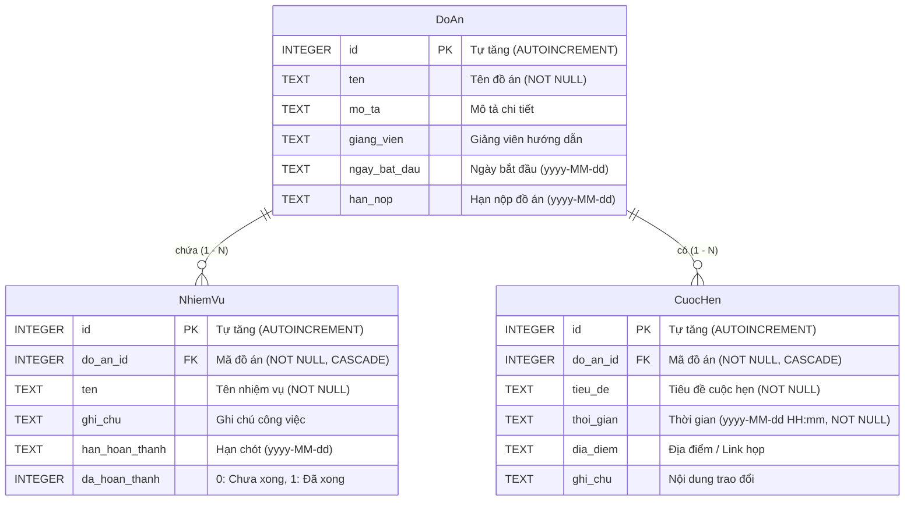
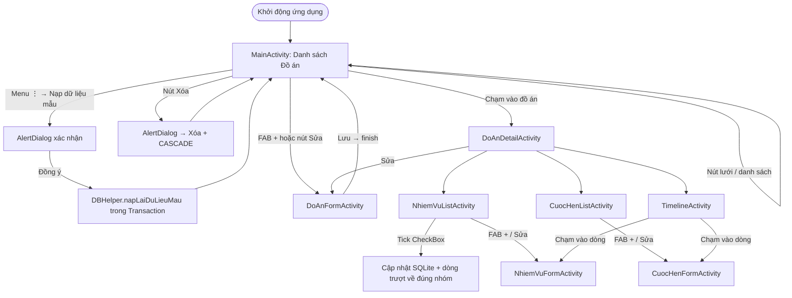

# BÁO CÁO BÀI TẬP LỚN LẬP TRÌNH THIẾT BỊ DI ĐỘNG
## ĐỀ TÀI: ỨNG DỤNG THEO DÕI TIẾN ĐỘ ĐỒ ÁN VÀ LỊCH HẸN GIẢNG VIÊN (ANDROID)

---

* **Học phần:** Lập trình Thiết bị Di động (LTTBDD)
* **Nền tảng:** Android (Java, SQLite thuần qua `SQLiteOpenHelper`, RecyclerView, Material Components)
* **Phiên bản hỗ trợ:** Android 7.0 (API 24) trở lên, `targetSdk 37`
* **Package:** `com.example.app`
* **Cơ sở dữ liệu:** `tiendo.db` (SQLite)

---

## MỤC LỤC
1. [Giới thiệu đề tài](#1-giới-thiệu-đề-tài)
2. [Phân tích yêu cầu](#2-phân-tích-yêu-cầu)
3. [Thiết kế Cơ sở Dữ liệu (CSDL)](#3-thiết-kế-cơ-sở-dữ-liệu-csdl)
4. [Thiết kế Giao diện Người dùng (UI/UX)](#4-thiết-kế-giao-diện-người-dùng-uiux)
5. [Thiết kế Kiến trúc và Kỹ thuật Lập trình](#5-thiết-kế-kiến-trúc-và-kỹ-thuật-lập-trình)
6. [Kiểm thử và Đánh giá](#6-kiểm-thử-và-đánh-giá)
7. [Kết quả đạt được, Hạn chế và Hướng phát triển](#7-kết-quả-đạt-được-hạn-chế-và-hướng-phát-triển)
8. [Phụ lục](#8-phụ-lục)

---

## 1. GIỚI THIỆU ĐỀ TÀI

### 1.1. Đặt vấn đề và bài toán thực tế
Trong quá trình học tập tại bậc đại học, sinh viên công nghệ thông tin và các ngành kỹ thuật thường xuyên phải thực hiện đồng thời nhiều loại đồ án khác nhau: Đồ án môn học, Thực tập chuyên ngành, Đề án khởi nghiệp, và Đồ án tốt nghiệp (Khóa luận tốt nghiệp). Mỗi đồ án kéo dài từ vài tuần đến hàng tháng, bao gồm khối lượng công việc lớn được chia thành nhiều giai đoạn, nhiều hạn chót (deadline) trung gian, cùng các buổi gặp gỡ, báo cáo định kỳ với Giảng viên hướng dẫn (GVHD).

Thực tế sinh viên hay gặp các khó khăn:
* Không nắm bắt được tiến độ tổng quát: Dễ bị "dồn ứ" khối lượng công việc vào sát ngày nộp.
* Bỏ quên các đầu việc nhỏ hoặc nhầm lẫn hạn hoàn thành giữa các môn học.
* Quên hoặc nhầm lẫn lịch hẹn, địa điểm gặp giảng viên (văn phòng bộ môn, phòng lab, phòng họp trực tuyến Google Meet/Zoom).
* Phụ thuộc vào các ứng dụng ghi chú rời rạc, không gắn liền trực tiếp giữa đồ án – nhiệm vụ – lịch hẹn.

### 1.2. Mục tiêu và đối tượng sử dụng
* **Đối tượng sử dụng chính:** Sinh viên đại học/cao đẳng cần công cụ cá nhân trực quan trên điện thoại để quản lý tiến độ học tập.
* **Mục tiêu của ứng dụng:** Xây dựng một ứng dụng Android hoàn chỉnh, hoạt động độc lập (offline-first), lưu trữ an toàn bằng SQLite thuần, cung cấp giao diện Material hiện đại giúp sinh viên dễ dàng theo dõi toàn bộ đồ án, nhiệm vụ và lịch hẹn một cách khoa học.

### 1.3. Phạm vi chức năng
* **Quản lý Đồ án (Projects):** Thêm, sửa, xóa thông tin đồ án, người hướng dẫn, thời gian bắt đầu và hạn nộp; hiển thị tiến độ hoàn thành tự động tính toán dạng tỷ lệ phần trăm (%).
* **Quản lý Nhiệm vụ (Tasks):** Chia nhỏ đồ án thành các đầu mục công việc, đặt hạn hoàn thành, đánh dấu nhanh trạng thái hoàn thành trực tiếp bằng checkbox.
* **Quản lý Cuộc hẹn (Appointments):** Đặt lịch trao đổi với giảng viên kèm mốc thời gian (ngày, giờ), địa điểm và nội dung cần trao đổi; tự động phân loại cuộc hẹn "Sắp diễn ra" và "Đã qua".
* **Bộ dữ liệu mẫu (Sample Data):** 25 bản ghi được nạp sẵn khi cài lần đầu và có thể nạp lại chỉ với một thao tác từ menu, hỗ trợ minh họa và nghiệm thu sản phẩm thuận tiện.

---

## 2. PHÂN TÍCH YÊU CẦU

### 2.1. Yêu cầu chức năng
1. **Quản trị Đồ án:**
   * Xem danh sách đồ án kèm thanh tiến độ trực quan, số đầu việc đã xong/tổng số; chuyển đổi chế độ xem danh sách / lưới 2 cột.
   * Xem chi tiết đồ án với 4 thẻ thống kê nhanh và dòng thời gian tổng hợp nhiệm vụ – lịch hẹn.
   * Thêm đồ án mới với ràng buộc: Hạn nộp phải sau hoặc bằng ngày bắt đầu; khi sửa, hạn nộp không được sớm hơn hạn của nhiệm vụ muộn nhất.
   * Chỉnh sửa thông tin đồ án đã có.
   * Xóa đồ án kèm cảnh báo xóa xếp tầng (cascade) toàn bộ nhiệm vụ và cuộc hẹn trực thuộc.
2. **Quản trị Nhiệm vụ:**
   * Xem danh sách nhiệm vụ của từng đồ án, tự động phân nhóm/sắp xếp: việc chưa hoàn thành lên trước, việc đã hoàn thành xuống dưới.
   * Thêm nhiệm vụ với ràng buộc: Hạn hoàn thành của nhiệm vụ không được vượt quá hạn nộp của đồ án.
   * Chỉnh sửa và xóa từng nhiệm vụ.
   * Chạm vào Checkbox để đảo trạng thái (hoàn thành / chưa xong); thanh tiến độ đồ án cập nhật tức thì.
3. **Quản trị Cuộc hẹn:**
   * Xem danh sách cuộc hẹn sắp xếp theo thứ tự thời gian tăng dần.
   * Hiển thị trực quan nhãn trạng thái (Badge): màu xanh lá *"Sắp diễn ra"* đối với cuộc hẹn trong tương lai, màu xám *"Đã qua"* đối với cuộc hẹn trong quá khứ so với thời điểm hiện tại.
   * Thêm, sửa, xóa cuộc hẹn với bộ chọn ngày (DatePicker) và bộ chọn giờ (TimePicker).
4. **Nạp dữ liệu mẫu:**
   * Dữ liệu mẫu (4 đồ án, 14 nhiệm vụ, 7 cuộc hẹn) được nạp tự động khi cài đặt lần đầu.
   * Mục **"Nạp dữ liệu mẫu"** trong menu ⋮ của màn hình chính cho phép khôi phục lại bộ dữ liệu này bất cứ lúc nào.
   * Vì thao tác thay thế toàn bộ dữ liệu hiện có, ứng dụng luôn hỏi xác nhận bằng hộp thoại trước khi thực hiện, và chạy trong Transaction để không bao giờ bị xóa dở dang.

### 2.2. Yêu cầu phi chức năng
* **Độ tương thích:** Hỗ trợ từ Android 7.0 (API 24 - Nougat) đến Android 15/16 (API 35-37).
* **Hiệu năng & Bộ nhớ:** Cuộn danh sách mượt nhờ cơ chế tái sử dụng ViewHolder của RecyclerView; tiến độ của mọi đồ án được tính bằng một truy vấn duy nhất; cập nhật giao diện bằng `notifyItemInserted/Removed/Moved` thay vì vẽ lại toàn bộ.
* **Độ tin cậy & Toàn vẹn:** Dữ liệu đang nhập không bị mất khi xoay màn hình; khóa ngoại `ON DELETE CASCADE` không để lại dữ liệu mồ côi; thao tác nạp lại dữ liệu mẫu chạy trong Transaction để đảm bảo tính nguyên tử.
* **Trải nghiệm người dùng (UX):** Thiết kế theo hướng dẫn Material Design 3, màu sắc tương phản rõ ràng, hỗ trợ đầy đủ Chế độ Tối (Dark Theme).

### 2.3. Sơ đồ Use Case tổng quát


---

## 3. THIẾT KẾ CƠ SỞ DỮ LIỆU (CSDL)

### 3.1. Sơ đồ Thực thể Mối quan hệ (ERD)



### 3.2. Mô tả chi tiết các bảng CSDL

#### Bảng 1: `DoAn` (Lưu thông tin đồ án)
* `id` (INTEGER, Primary Key, Auto Increment): Mã định danh duy nhất của đồ án.
* `ten` (TEXT, NOT NULL): Tên đồ án hoặc đề tài nghiên cứu.
* `mo_ta` (TEXT, Nullable): Tóm tắt mục tiêu, nội dung đồ án.
* `giang_vien` (TEXT, Nullable): Họ và tên, học hàm học vị của GVHD.
* `ngay_bat_dau` (TEXT, Nullable): Ngày khởi động làm đồ án theo định dạng chuẩn ISO-8601 (`yyyy-MM-dd`).
* `han_nop` (TEXT, Nullable): Ngày phải nộp đồ án (`yyyy-MM-dd`).

#### Bảng 2: `NhiemVu` (Lưu các đầu việc thuộc đồ án)
* `id` (INTEGER, Primary Key, Auto Increment): Mã nhiệm vụ.
* `do_an_id` (INTEGER, NOT NULL, Foreign Key): Khóa ngoại liên kết tới `DoAn(id)` với thuộc tính `ON DELETE CASCADE`.
* `ten` (TEXT, NOT NULL): Tên đầu việc cần làm.
* `ghi_chu` (TEXT, Nullable): Hướng dẫn, lưu ý khi thực hiện.
* `han_hoan_thanh` (TEXT, Nullable): Hạn chót của việc (`yyyy-MM-dd`).
* `da_hoan_thanh` (INTEGER, NOT NULL, DEFAULT 0): Cờ trạng thái (0: Chưa xong, 1: Đã hoàn thành).

#### Bảng 3: `CuocHen` (Lưu lịch hẹn gặp GVHD)
* `id` (INTEGER, Primary Key, Auto Increment): Mã cuộc hẹn.
* `do_an_id` (INTEGER, NOT NULL, Foreign Key): Khóa ngoại liên kết tới `DoAn(id)` với thuộc tính `ON DELETE CASCADE`.
* `tieu_de` (TEXT, NOT NULL): Nội dung hoặc chủ đề buổi hẹn.
* `thoi_gian` (TEXT, NOT NULL): Thời điểm hẹn đầy đủ ngày và giờ (`yyyy-MM-dd HH:mm`).
* `dia_diem` (TEXT, Nullable): Phòng học, văn phòng khoa, phòng lab hoặc đường dẫn phòng họp trực tuyến.
* `ghi_chu` (TEXT, Nullable): Nội dung cần chuẩn bị hoặc kết quả trao đổi.

---

### 3.3. Giải thích các quyết định thiết kế CSDL

#### 1. Lý do tách thành 3 bảng riêng biệt
Theo nguyên lý chuẩn hóa cơ sở dữ liệu (đạt dạng chuẩn 3NF):
* Một đồ án có thể có không giới hạn số lượng nhiệm vụ và cuộc hẹn.
* Các thuộc tính của `NhiemVu` (như `han_hoan_thanh`, `da_hoan_thanh`) chỉ phụ thuộc vào nhiệm vụ cụ thể, không phụ thuộc trực tiếp vào toàn bộ đồ án.
* Việc tách riêng giúp tránh dư thừa dữ liệu (data redundancy), loại bỏ hoàn toàn các bất thường khi cập nhật (update anomalies), chèn (insert anomalies) hoặc xóa (delete anomalies).

#### 2. Khóa ngoại và ràng buộc `ON DELETE CASCADE`
* **Vấn đề thực tế:** Khi một sinh viên hủy bỏ hoặc xóa một đồ án, tất cả nhiệm vụ và cuộc hẹn của đồ án đó sẽ trở thành "dữ liệu mồ côi" (orphaned records) nếu không được dọn dẹp, gây lãng phí dung lượng lưu trữ và sai lệch thống kê.
* **Giải pháp:** Thiết lập khóa ngoại `REFERENCES DoAn(id) ON DELETE CASCADE` và bật ràng buộc này trong `DBHelper.onConfigure(SQLiteDatabase db)` bằng `db.setForeignKeyConstraintsEnabled(true);`. Khi xóa một dòng trong bảng `DoAn`, hệ thống SQLite tự động xóa sạch toàn bộ các dòng liên quan trong `NhiemVu` và `CuocHen` ở cấp độ CSDL, không cần phải viết thủ công nhiều câu lệnh xóa phức tạp ở tầng ứng dụng.

#### 3. Vì sao lưu trữ ngày giờ dạng `TEXT` (`yyyy-MM-dd` và `yyyy-MM-dd HH:mm`)?
SQLite không có kiểu dữ liệu `DATE` hay `DATETIME` riêng mà sử dụng cơ chế Dynamic Typing với 5 kiểu cơ bản (NULL, INTEGER, REAL, TEXT, BLOB).
Định dạng chuỗi chuẩn ISO-8601 được lựa chọn vì 3 lý do kỹ thuật:
1. **Khả năng so sánh và sắp xếp tự nhiên:** Định dạng chuỗi `yyyy-MM-dd` có thứ tự sắp xếp từ lớn đến nhỏ (năm $\rightarrow$ tháng $\rightarrow$ ngày). Do đó, phép so sánh từ vựng (lexicographical comparison) thông thường trùng khớp hoàn toàn với thứ tự thời gian (`"2026-03-01" < "2026-06-30"`). Ta có thể dùng trực tiếp toán tử `<`, `>`, `=` và `ORDER BY thoi_gian ASC` trong SQL mà không cần chuyển đổi.
2. **Dễ đọc, gỡ lỗi và đồng bộ:** Dữ liệu khi xem bằng DB Browser for SQLite hoặc xuất ra JSON hoàn toàn trực quan, không bị phụ thuộc vào định dạng epoch millisecond khó đọc đối với con người.
3. **Tương thích hoàn hảo với các hàm thời gian của SQLite:** SQLite hỗ trợ sẵn các hàm `date()`, `time()`, `datetime()`, `strftime()` thao tác trực tiếp trên chuỗi định dạng ISO này.

#### 4. Vì sao tính tiến độ bằng truy vấn thay vì lưu cứng cột `tien_do` trong bảng `DoAn`?
Nếu thêm cột `tien_do` (hoặc `phan_tram`) vào bảng `DoAn`:
* Mỗi khi thêm một nhiệm vụ, xóa một nhiệm vụ, hoặc người dùng chạm Checkbox để đổi trạng thái một nhiệm vụ, ta bắt buộc phải nhớ cập nhật lại bảng `DoAn`.
* Nếu có bất kỳ lỗi logic nào xảy ra khiến việc cập nhật bảng `DoAn` thất bại, dữ liệu giữa bảng `DoAn` và bảng `NhiemVu` sẽ bị **mất đồng bộ (inconsistent state)**.
* **Giải pháp tối ưu:** Tiến độ là **dữ liệu phái sinh (derived data)**. Ứng dụng sử dụng câu truy vấn `LEFT JOIN` kết hợp hàm gom nhóm `COUNT(n.id)` và `IFNULL(SUM(n.da_hoan_thanh), 0)` để tính toán động tại thời điểm truy vấn. Bằng cách này, tiến độ luôn phản ánh đúng 100% sự thật trạng thái của các nhiệm vụ trong CSDL mà không có nguy cơ lệch pha dữ liệu.

#### 5. Vì sao chọn SQLite thuần (`SQLiteOpenHelper`) thay vì thư viện Room?
Đồ án lựa chọn sử dụng SQLite thuần theo đúng định hướng môn học:
1. **Nắm vững bản chất cốt lõi của Android OS:** Giúp sinh viên hiểu sâu sắc về kiến trúc CSDL nhúng, vòng đời của `SQLiteOpenHelper` (`onCreate`, `onUpgrade`, `onConfigure`), cách quản lý con trỏ `Cursor` và cú pháp SQL tiêu chuẩn mà không bị che khuất bởi các lớp trừu tượng (abstraction layer).
2. **Không làm phình to dung lượng ứng dụng:** Thư viện Room yêu cầu Annotation Processor (KSP/kapt) và nhiều thư viện bổ trợ runtime, làm tăng thời gian build và kích thước file APK. Sử dụng SQLite thuần giữ cho dự án nhẹ, độc lập và dễ bảo trì trên mọi môi trường biên dịch.

---

## 4. THIẾT KẾ GIAO DIỆN NGƯỜI DÙNG (UI/UX)

### 4.1. Danh sách màn hình và các thành phần giao diện
Ứng dụng gồm **8 Activity**, mỗi Activity đảm nhận đúng một nhiệm vụ (thêm/sửa luôn mở sang một màn hình Form riêng).

| STT | Activity | Layout | Chức năng chính |
| :---: | :--- | :--- | :--- |
| 1 | `MainActivity` | `activity_main.xml`, `row_do_an.xml` | Danh sách đồ án kèm thanh tiến độ; chuyển chế độ **Danh sách / Lưới 2 cột**; menu ⋮ **Nạp dữ liệu mẫu**; FAB thêm đồ án |
| 2 | `DoAnFormActivity` | `activity_do_an_form.xml` | Thêm / sửa đồ án; chọn ngày bằng `DatePickerDialog` |
| 3 | `DoAnDetailActivity` | `activity_do_an_detail.xml`, `row_thong_ke.xml` | Thông tin đồ án, thanh tiến độ tổng, **RecyclerView cuộn ngang** 4 thẻ thống kê; nút sang Nhiệm vụ / Cuộc hẹn / Dòng thời gian; sửa, xóa đồ án |
| 4 | `NhiemVuListActivity` | `activity_nhiem_vu_list.xml`, `row_nhiem_vu.xml` | Danh sách nhiệm vụ (chưa xong lên trước), CheckBox đánh dấu hoàn thành, sửa / xóa |
| 5 | `NhiemVuFormActivity` | `activity_nhiem_vu_form.xml` | Thêm / sửa nhiệm vụ, kiểm tra hạn không vượt hạn nộp đồ án |
| 6 | `CuocHenListActivity` | `activity_cuoc_hen_list.xml`, `row_cuoc_hen.xml` | Danh sách cuộc hẹn theo thời gian tăng dần, nhãn *Sắp diễn ra* / *Đã qua* |
| 7 | `CuocHenFormActivity` | `activity_cuoc_hen_form.xml` | Thêm / sửa cuộc hẹn; chọn liên tiếp `DatePickerDialog` → `TimePickerDialog` |
| 8 | `TimelineActivity` | `activity_timeline.xml`, `row_header.xml`, `row_timeline_task.xml`, `row_timeline_meeting.xml` | Dòng thời gian gộp Nhiệm vụ và Lịch hẹn trong **một** RecyclerView nhiều kiểu dòng |

Các thành phần dùng chung:
* `Toolbar` có nút quay lại trên mọi màn hình con.
* `layoutEmpty*`: giao diện trạng thái rỗng (Empty State) khi danh sách chưa có dữ liệu.
* `AlertDialog.Builder`: hộp thoại xác nhận xóa và xác nhận nạp dữ liệu mẫu.
* `Toast`: thông báo nhanh kết quả thao tác và lỗi kiểm tra dữ liệu.
* Các Form được bọc trong `ScrollView` để không bị che khi xoay ngang hoặc khi bàn phím hiện lên.

### 4.2. Luồng điều hướng (Navigation Flow)



### 4.3. Lý do lựa chọn các thành phần giao diện

#### 1. Mỗi chức năng một Activity, truyền dữ liệu bằng `Intent`
* Luồng màn hình tuyến tính, dễ hiểu và bám sát bài giảng (tương tự bài mẫu "Quản lý sinh viên").
* ID đối tượng được truyền qua `intent.putExtra(EXTRA_DO_AN_ID, id)`; tên khóa được khai báo bằng hằng số `public static final String` trong Activity nhận để phía gửi và phía nhận không bao giờ gõ lệch chuỗi.
* Khi Form đóng (`finish()`), màn hình danh sách tự nạp lại dữ liệu mới trong `onResume()`.

#### 2. `RecyclerView` thay cho `ListView`
* Bắt buộc dùng **ViewHolder Pattern**: tái sử dụng View đã cuộn khỏi màn hình, giảm số lần gọi `findViewById`.
* `LayoutManager` linh hoạt: dự án dùng cả `LinearLayoutManager` dọc (danh sách), `GridLayoutManager` 2 cột (chế độ lưới ở màn hình chính, lựa chọn được lưu bằng `SharedPreferences`) và `LinearLayoutManager.HORIZONTAL` (thẻ thống kê).
* `ItemAnimator` có sẵn hiệu ứng thêm / xóa / di chuyển dòng.

#### 3. Nhiều kiểu dòng (Multiple View Types) cho Dòng thời gian
* `TimelineAdapter` nhận `List<Object>` gồm `String` (tiêu đề nhóm), `NhiemVu` và `CuocHen`; `getItemViewType()` dùng `instanceof` để chọn layout tương ứng.
* Hiển thị hai loại dữ liệu khác nhau trên một danh sách liền mạch mà không cần lồng nhiều RecyclerView.

#### 4. `DatePickerDialog` / `TimePickerDialog`
* Người dùng không phải tự gõ ngày, tránh sai định dạng. Giá trị trả về được định dạng ngay thành `yyyy-MM-dd` hoặc `yyyy-MM-dd HH:mm` bằng `String.format(Locale.US, ...)` (dùng `Locale.US` để chữ số luôn là 0–9 trên mọi ngôn ngữ máy, giữ đúng phép so sánh chuỗi).

#### 5. `findViewById` + `setOnClickListener`
* Đúng kỹ thuật được dạy trên lớp, không cần bật thêm tính năng build, dễ giải thích từng dòng khi vấn đáp.

#### 6. Material Components (Theme `Material3.DayNight`)
* `MaterialCardView`, `FloatingActionButton`, `Toolbar` cho giao diện hiện đại, tự hỗ trợ chế độ tối (`values-night/themes.xml`).

---

## 5. THIẾT KẾ KIẾN TRÚC VÀ KỸ THUẬT LẬP TRÌNH

### 5.1. Cấu trúc mã nguồn

```
app/src/main/java/com/example/app/      (package phẳng, không chia tầng)
├── DBHelper.java              // SQLiteOpenHelper: tạo bảng, dữ liệu mẫu, CRUD 3 bảng, thống kê
├── DoAn.java                  // Model Đồ án (+ tongNhiemVu, soNhiemVuXong để vẽ tiến độ)
├── NhiemVu.java               // Model Nhiệm vụ
├── CuocHen.java               // Model Cuộc hẹn
├── ThongKeItem.java           // Model thẻ thống kê (tiêu đề, giá trị, icon)
├── MainActivity.java          // Danh sách đồ án, chuyển list/grid, menu nạp dữ liệu mẫu
├── DoAnAdapter.java
├── DoAnFormActivity.java
├── DoAnDetailActivity.java    // Chi tiết + RecyclerView ngang thống kê
├── ThongKeAdapter.java
├── NhiemVuListActivity.java
├── NhiemVuAdapter.java        // CheckBox hoàn thành + gạch ngang
├── NhiemVuFormActivity.java
├── CuocHenListActivity.java
├── CuocHenAdapter.java        // Nhãn Sắp diễn ra / Đã qua
├── CuocHenFormActivity.java
├── TimelineActivity.java
└── TimelineAdapter.java       // 3 kiểu dòng: HEADER / TASK / MEETING

app/src/main/res/
├── layout/   8 layout màn hình + 7 layout dòng (row_*.xml)
├── drawable/ icon vector, nền badge, progress drawable
├── menu/menu_main.xml         // Nút chuyển list/grid + mục "Nạp dữ liệu mẫu"
└── values/, values-night/     // colors, strings, themes (sáng / tối)
```

**Lý do chọn cấu trúc phẳng:** dự án có quy mô vừa (18 lớp), một package duy nhất giúp người đọc thấy toàn bộ mã nguồn ngay lập tức, bám sát bài mẫu trên lớp và dễ trình bày khi bảo vệ. Toàn bộ truy cập CSDL tập trung trong một lớp `DBHelper`, nên các Activity không chứa câu SQL nào.

### 5.2. Các kỹ thuật lập trình then chốt (trích mã nguồn thực tế)

#### 1. Bật khóa ngoại để `ON DELETE CASCADE` hoạt động
```java
// DBHelper.java
@Override
public void onConfigure(SQLiteDatabase db) {
    super.onConfigure(db);
    db.setForeignKeyConstraintsEnabled(true);
}
```
SQLite mặc định **tắt** kiểm tra khóa ngoại; nếu không bật, xóa đồ án sẽ để lại nhiệm vụ và cuộc hẹn "mồ côi".

#### 2. Tính tiến độ của tất cả đồ án bằng một truy vấn `LEFT JOIN`
```java
// DBHelper.getAllDoAn()
String sql = "SELECT d.id, d.ten, d.mo_ta, d.giang_vien, d.ngay_bat_dau, d.han_nop, " +
        "COUNT(n.id) AS tong, " +
        "IFNULL(SUM(n.da_hoan_thanh), 0) AS xong " +
        "FROM DoAn d " +
        "LEFT JOIN NhiemVu n ON d.id = n.do_an_id " +
        "GROUP BY d.id " +
        "ORDER BY d.id DESC";
```
* Một lần gọi CSDL cho toàn bộ danh sách (không lặp `N + 1` truy vấn).
* `LEFT JOIN` giữ lại đồ án chưa có nhiệm vụ; `IFNULL(..., 0)` tránh giá trị `NULL` khi `SUM` trên tập rỗng.

#### 3. Sắp xếp nhiệm vụ: chưa xong lên trước, đã xong xuống dưới
```java
// DBHelper.getNhiemVuByDoAnId()
"ORDER BY da_hoan_thanh ASC, " +
"CASE WHEN han_hoan_thanh IS NULL OR han_hoan_thanh = '' THEN 1 ELSE 0 END, " +
"han_hoan_thanh ASC, id ASC"
```
* Trong mỗi nhóm, việc có hạn gần nhất đứng đầu; việc chưa đặt hạn xếp cuối nhóm.
* Sắp xếp ngay trong SQL nên cả `NhiemVuListActivity` và `TimelineActivity` cùng dùng chung thứ tự này.
* Khi người dùng tick CheckBox, `NhiemVuListActivity.onToggleStatus()` ghi CSDL, đọc lại danh sách đã sắp xếp, tìm vị trí mới của nhiệm vụ và gọi `notifyItemMoved(viTriCu, viTriMoi)`. Dòng trượt về đúng nhóm có hiệu ứng mà không phải vẽ lại toàn bộ danh sách.

#### 4. Ràng buộc hạn hoàn thành nhiệm vụ ≤ hạn nộp đồ án (kiểm tra hai chiều)
```java
// NhiemVuFormActivity.luuNhiemVu()
if (!hanHoanThanh.isEmpty()) {
    DoAn doAn = dbHelper.getDoAnById(doAnId);
    String hanNopDoAn = (doAn != null && doAn.getHanNop() != null) ? doAn.getHanNop().trim() : "";
    if (!hanNopDoAn.isEmpty() && hanHoanThanh.compareTo(hanNopDoAn) > 0) {
        Toast.makeText(this, "Hạn hoàn thành không được sau hạn nộp đồ án (" + hanNopDoAn + ")!", Toast.LENGTH_LONG).show();
        return;
    }
}
```
```java
// DoAnFormActivity.luuDoAn() – khi sửa đồ án, không cho dời hạn nộp sớm hơn nhiệm vụ muộn nhất
String hanNhiemVuMuonNhat = dbHelper.getHanNhiemVuMuonNhat(doAnId); // SELECT MAX(han_hoan_thanh) ...
if (hanNhiemVuMuonNhat != null && hanNop.compareTo(hanNhiemVuMuonNhat) < 0) { ... return; }
```
Nếu chỉ kiểm tra ở Form nhiệm vụ, người dùng vẫn có thể phá vỡ ràng buộc bằng cách sửa hạn nộp của đồ án. Vì vậy ràng buộc được kiểm tra ở cả hai phía. Phép so sánh chuỗi `compareTo` hợp lệ nhờ định dạng `yyyy-MM-dd` (mục 3.3.3).

#### 5. Nạp lại dữ liệu mẫu an toàn bằng Transaction
```java
// DBHelper.napLaiDuLieuMau()
SQLiteDatabase db = this.getWritableDatabase();
db.beginTransaction();
try {
    db.execSQL("DELETE FROM CuocHen");
    db.execSQL("DELETE FROM NhiemVu");
    db.execSQL("DELETE FROM DoAn");
    db.execSQL("DELETE FROM sqlite_sequence WHERE name IN ('DoAn', 'NhiemVu', 'CuocHen')");
    chenDuLieuMau(db);
    db.setTransactionSuccessful();
} finally {
    db.endTransaction();
}
```
* Hàm `chenDuLieuMau(db)` được dùng chung cho `onCreate` (lần cài đầu tiên) và cho menu, nên chỉ có **một** nguồn dữ liệu mẫu trong mã.
* Nếu có lỗi giữa chừng, `setTransactionSuccessful()` không được gọi và CSDL quay về trạng thái cũ, không bao giờ bị "xóa một nửa".
* Vì thao tác này xóa dữ liệu người dùng, `MainActivity` luôn hỏi xác nhận bằng `AlertDialog` trước khi thực hiện.
* Xóa `sqlite_sequence` để bộ đếm `AUTOINCREMENT` bắt đầu lại sau id của dữ liệu mẫu.

#### 6. Truyền tham số bằng dấu `?` (chống SQL Injection)
```java
db.execSQL("UPDATE NhiemVu SET da_hoan_thanh = ? WHERE id = ?", new Object[]{daHoanThanh, id});
db.rawQuery("SELECT ... FROM NhiemVu WHERE do_an_id = ?", new String[]{String.valueOf(doAnId)});
```
Dữ liệu người dùng nhập có dấu nháy `'` (ví dụ "Báo cáo 'giữa kỳ'") vẫn được lưu đúng, không gây lỗi cú pháp SQL.

#### 7. Hàm dùng chung xác định cuộc hẹn đã qua
```java
private static final SimpleDateFormat DATE_TIME_FORMAT = new SimpleDateFormat("yyyy-MM-dd HH:mm", Locale.US);

public static boolean laDaQua(String thoiGian) {
    if (thoiGian == null || thoiGian.trim().isEmpty()) return false;
    String currentDateTime = DATE_TIME_FORMAT.format(new Date());
    return thoiGian.trim().compareTo(currentDateTime) < 0;
}
```
`CuocHenAdapter` và `TimelineAdapter` cùng gọi hàm này nên nhãn *Sắp diễn ra* / *Đã qua* luôn thống nhất giữa các màn hình.

#### 8. Lấy vị trí an toàn trong ViewHolder
```java
int position = getAdapterPosition();
if (position == RecyclerView.NO_POSITION) return;
```
Khi dòng đang chạy hiệu ứng xóa, vị trí có thể là `-1`; việc kiểm tra giúp tránh `IndexOutOfBoundsException`.

---

## 6. KIỂM THỬ VÀ ĐÁNH GIÁ

### 6.1. Kiểm tra truy vấn trên bộ dữ liệu mẫu
Các truy vấn mới được chạy thử trên SQLite với đúng bộ dữ liệu mẫu (4 đồ án, 14 nhiệm vụ, 7 cuộc hẹn):

| Kiểm tra | Kết quả |
| :--- | :--- |
| Số bản ghi nạp được | 4 / 14 / 7, khớp tệp `du_lieu_mau.sql` |
| Nhiệm vụ mẫu vi phạm hạn nộp đồ án | Không có |
| Thứ tự nhiệm vụ Đồ án 1 (id) | `3, 4, 1, 2` (2 việc chưa xong theo hạn, rồi 2 việc đã xong) |
| Thứ tự nhiệm vụ Đồ án 2 (id) | `6, 7, 5` |
| Tiến độ 4 đồ án | 50%, 33%, 100%, 0% |

### 6.2. Bảng kiểm thử thao tác (Manual Testing Checklist)

| STT | Kịch bản kiểm thử | Thao tác thực hiện | Kết quả mong đợi | Đánh giá |
| :---: | :--- | :--- | :--- | :---: |
| 1 | Khởi động lần đầu | Cài mới và mở ứng dụng | Hiển thị sẵn 4 đồ án mẫu với tiến độ 50%, 33%, 100%, 0% | `[ ]` |
| 2 | Nạp lại dữ liệu mẫu | Menu ⋮ → "Nạp dữ liệu mẫu" → "Nạp dữ liệu" | Hỏi xác nhận; dữ liệu cũ bị thay bằng 4 đồ án mẫu | `[ ]` |
| 3 | Hủy nạp dữ liệu mẫu | Menu ⋮ → "Nạp dữ liệu mẫu" → "Hủy" | Dữ liệu hiện tại giữ nguyên | `[ ]` |
| 4 | Ràng buộc ngày đồ án | Thêm đồ án có hạn nộp trước ngày bắt đầu | Báo lỗi, không cho lưu | `[ ]` |
| 5 | Ràng buộc hạn nhiệm vụ | Đồ án 2 (hạn 2026-11-20) → thêm nhiệm vụ hạn 2026-12-01 | Báo lỗi "Hạn hoàn thành không được sau hạn nộp đồ án", không lưu | `[ ]` |
| 6 | Ràng buộc chiều ngược | Sửa Đồ án 1, đổi hạn nộp thành 2026-12-01 (nhiệm vụ muộn nhất 2026-12-25) | Báo lỗi, không cho lưu | `[ ]` |
| 7 | Sắp xếp nhiệm vụ | Mở nhiệm vụ Đồ án 1 | Hai việc chưa xong ở trên, hai việc đã xong (gạch ngang) ở dưới | `[ ]` |
| 8 | Tick hoàn thành | Tick một việc chưa xong | Dòng gạch ngang và trượt xuống nhóm đã xong; quay lại chi tiết thấy % tăng | `[ ]` |
| 9 | Phân loại cuộc hẹn | Mở danh sách cuộc hẹn Đồ án 1 | Cuộc hẹn quá khứ nhãn "Đã qua", tương lai nhãn "Sắp diễn ra" | `[ ]` |
| 10 | Xóa xếp tầng | Xóa một đồ án | Nhiệm vụ và cuộc hẹn của đồ án đó biến mất | `[ ]` |
| 11 | Chuyển lưới / danh sách | Bấm nút trên Toolbar, thoát và mở lại app | Chế độ xem được giữ nguyên | `[ ]` |
| 12 | Xoay màn hình | Đang nhập dở Form → xoay ngang | Dữ liệu đang nhập không mất | `[ ]` |

*(Đánh dấu kết quả sau khi chạy APK trên máy ảo hoặc điện thoại thật.)*

---

## 7. KẾT QUẢ ĐẠT ĐƯỢC, HẠN CHẾ VÀ HƯỚNG PHÁT TRIỂN

### 7.1. Kết quả đạt được
* Ứng dụng Android hoàn chỉnh viết bằng Java, dùng SQLite thuần qua `SQLiteOpenHelper`, không dùng thư viện ngoài ngoài AndroidX/Material.
* Đủ CRUD cho 3 bảng có quan hệ 1–N, xóa xếp tầng, tiến độ tính động, ràng buộc ngày tháng hai chiều.
* Ứng dụng nhiều kỹ thuật RecyclerView: danh sách dọc, lưới, cuộn ngang, nhiều kiểu dòng, `notifyItemInserted/Removed/Moved`.
* Bộ dữ liệu mẫu 25 bản ghi có sẵn khi cài và nạp lại được bất cứ lúc nào để minh họa.

### 7.2. Các hạn chế đã biết
1. **`onUpgrade` xóa bảng rồi tạo lại:** tiện cho giai đoạn phát triển nhưng sẽ mất dữ liệu nếu tăng `DATABASE_VERSION`. Sản phẩm thực tế cần migration bằng `ALTER TABLE`.
2. **Xoay màn hình bằng `android:configChanges`:** Activity không bị tạo lại nên dữ liệu đang nhập được giữ, nhưng đây là cách làm tắt. Cách chuẩn hơn là lưu trạng thái bằng `onSaveInstanceState` hoặc `ViewModel`.
3. **Truy vấn CSDL chạy trên luồng giao diện:** chấp nhận được với dữ liệu nhỏ; nếu dữ liệu lớn cần chuyển sang luồng nền (`ExecutorService`).
4. **Nhãn trạng thái cuộc hẹn** chỉ được tính lại khi danh sách được nạp lại hoặc cuộn, không tự đổi khi để màn hình mở qua giờ hẹn.
5. **Chưa có kiểm thử tự động** cho CSDL và giao diện; các ca kiểm thử ở mục 6.2 được thực hiện thủ công.

### 7.3. Hướng phát triển
* Nhắc lịch hẹn bằng thông báo (`AlarmManager` / `WorkManager`).
* Tìm kiếm đồ án (`SearchView`) và lọc nhiệm vụ theo trạng thái / hạn chót.
* Sao lưu / phục hồi dữ liệu ra tệp JSON.

---

## 8. PHỤ LỤC

### 8.1. Hướng dẫn cài đặt APK
1. Tệp nộp bài: `deliverables/ung_dung_theo_doi_do_an.apk` (bản debug, cài được ngay).
2. **Cách 1 (ADB):** `adb install -r deliverables/ung_dung_theo_doi_do_an.apk`
3. **Cách 2 (trực tiếp):** chép tệp APK vào điện thoại, mở bằng Trình quản lý tệp, cho phép "Cài đặt từ nguồn không xác định" rồi bấm *Cài đặt*.
4. Nếu máy đã cài bản cũ, chọn menu ⋮ → **Nạp dữ liệu mẫu** để có đúng bộ dữ liệu minh họa mới nhất.

### 8.2. Cấu trúc thư mục bàn giao (`deliverables/`)
```
deliverables/
├── ung_dung_theo_doi_do_an.apk      // Tệp cài đặt
├── du_lieu_mau/
│   ├── du_lieu_mau.sql             // 25 bản ghi, trùng khớp DBHelper.chenDuLieuMau()
│   └── du_lieu_mau.json            // Cùng dữ liệu ở dạng JSON lồng nhau
├── thiet_ke/                        // Tệp thiết kế
│   ├── AndroidManifest.xml
│   ├── java/com/example/app/       // 18 tệp .java
│   └── res/                        // layout, drawable, menu, values (.xml)
└── bao_cao/
    ├── bao_cao.md                  // Báo cáo này
    ├── GIAI_THICH_THIET_KE.md      // Giải thích lý do chọn từng quyết định thiết kế
    └── giai_thich_don_gian.md      // Giải thích mã nguồn bằng ngôn ngữ đơn giản
```

### 8.3. Vị trí ảnh chụp màn hình minh họa
* [Chèn ảnh: Màn hình chính chế độ danh sách và chế độ lưới]
* [Chèn ảnh: Menu ⋮ "Nạp dữ liệu mẫu" và hộp thoại xác nhận]
* [Chèn ảnh: Chi tiết đồ án với thẻ thống kê cuộn ngang]
* [Chèn ảnh: Danh sách nhiệm vụ – việc chưa xong ở trên, đã xong ở dưới]
* [Chèn ảnh: Thông báo lỗi khi hạn nhiệm vụ vượt hạn nộp đồ án]
* [Chèn ảnh: Danh sách cuộc hẹn với nhãn Sắp diễn ra / Đã qua]
* [Chèn ảnh: Dòng thời gian (Timeline)]
