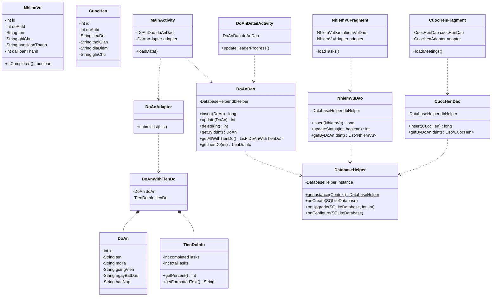
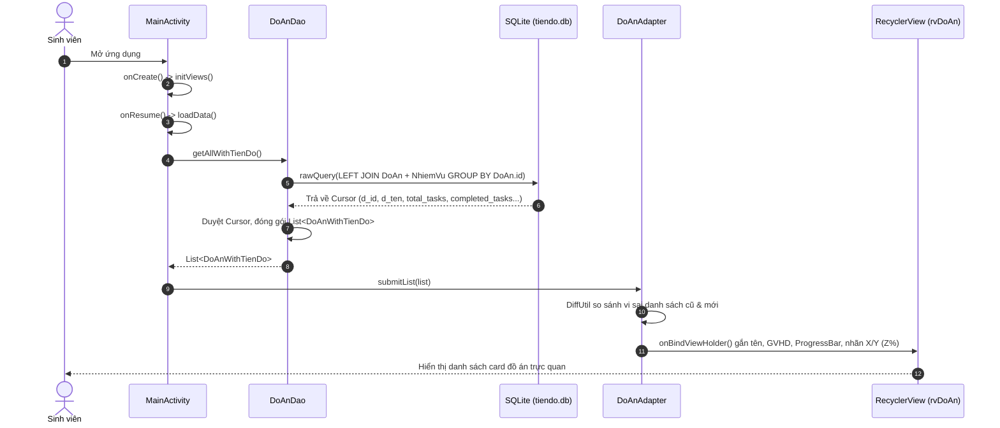
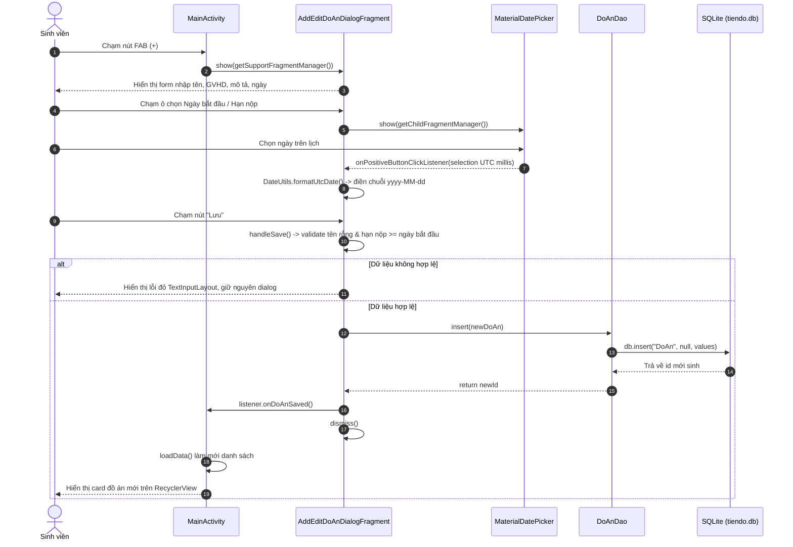
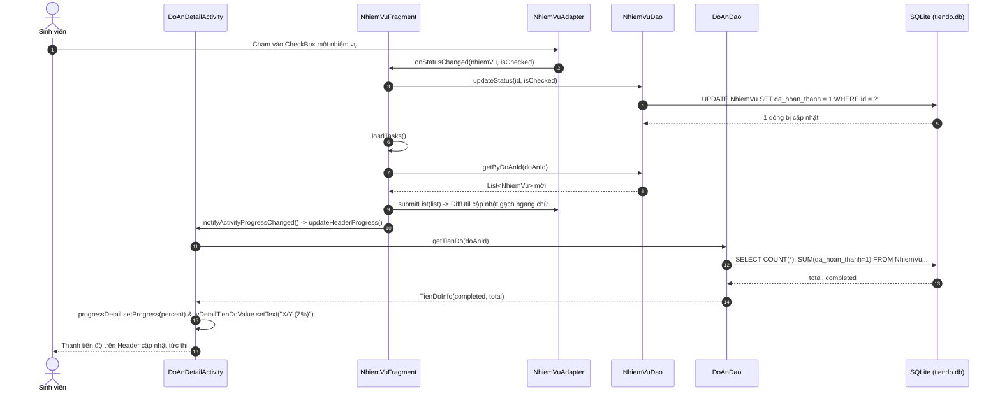
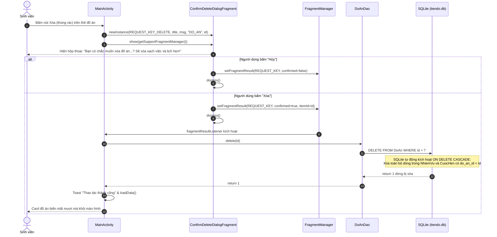

# TÀI LIỆU TOÀN DIỆN GIẢI THÍCH CHI TIẾT MÃ NGUỒN DỰ ÁN
## ĐỀ TÀI: ỨNG DỤNG THEO DÕI ĐỒ ÁN VÀ LỊCH HẸN GIẢNG VIÊN (ANDROID)
*Tài liệu phục vụ báo cáo bài tập lớn và bảo vệ đồ án*

---

## MỤC LỤC TỔNG THỂ

1. [Sơ đồ Kiến trúc và Sơ đồ Tuần tự (Mermaid)](#1-sơ-đồ-kiến-trúc-và-sơ-đồ-tuần-tự)
   * 1.1. Sơ đồ Quan hệ Phụ thuộc giữa các Lớp (Class Diagram)
   * 1.2. Luồng 1: Mở app và hiển thị danh sách đồ án kèm tiến độ
   * 1.3. Luồng 2: Thêm đồ án mới qua Dialog
   * 1.4. Luồng 3: Tick hoàn thành nhiệm vụ và cập nhật tiến độ
   * 1.5. Luồng 4: Xóa có xác nhận bằng ConfirmDeleteDialogFragment và xóa tầng (Cascade)
2. [Nhóm A: Mô hình Dữ liệu (`com.example.app.model`)](#2-nhóm-a-mô-hình-dữ-liệu-model)
   * 2.1. `DoAn.java` (15 hàm)
   * 2.2. `NhiemVu.java` (19 hàm)
   * 2.3. `CuocHen.java` (17 hàm)
   * 2.4. `TienDoInfo.java` (8 hàm)
   * 2.5. `DoAnWithTienDo.java` (8 hàm)
3. [Nhóm B: Cơ sở Dữ liệu & DAO (`com.example.app.db`)](#3-nhóm-b-cơ-sở-dữ-liệu--dao)
   * 3.1. `DatabaseHelper.java` (5 hàm)
   * 3.2. `DoAnDao.java` (11 hàm)
   * 3.3. `NhiemVuDao.java` (11 hàm)
   * 3.4. `CuocHenDao.java` (10 hàm)
4. [Nhóm C: Tiện ích (`com.example.app.util`)](#4-nhóm-c-tiện-ích-utilities)
   * 4.1. `DateUtils.java` (14 hàm)
   * 4.2. `SampleDataLoader.java` (8 hàm)
5. [Nhóm D: Bộ điều phối danh sách (`com.example.app.adapter`)](#5-nhóm-d-bộ-điều-phối-adapter)
   * 5.1. `DoAnAdapter.java` (10 hàm)
   * 5.2. `NhiemVuAdapter.java` (10 hàm)
   * 5.3. `CuocHenAdapter.java` (9 hàm)
6. [Nhóm E: Giao diện & Điều khiển (`com.example.app` & `com.example.app.ui`)](#6-nhóm-e-giao-diện--điều-khiển-ui)
   * 6.1. `MainActivity.java` (12 hàm)
   * 6.2. `DoAnDetailActivity.java` (8 hàm)
   * 6.3. `NhiemVuFragment.java` (12 hàm)
   * 6.4. `CuocHenFragment.java` (10 hàm)
   * 6.5. `AddEditDoAnDialogFragment.java` (11 hàm)
   * 6.6. `AddEditNhiemVuDialogFragment.java` (10 hàm)
   * 6.7. `AddEditCuocHenDialogFragment.java` (12 hàm)
   * 6.8. `ConfirmDeleteDialogFragment.java` (2 hàm)
7. [Nhóm F: Tài nguyên & Cấu hình (`res/`, Manifest, Gradle)](#7-nhóm-f-tài-nguyên--cấu-hình)
   * 7.1. Danh sách 10 tệp giao diện XML layout
   * 7.2. Bảng tài nguyên đồ họa Drawables
   * 7.3. Bảng tài nguyên Giá trị Values (`colors`, `strings`, `themes`)
   * 7.4. Cấu hình `AndroidManifest.xml`
   * 7.5. Cấu hình `app/build.gradle.kts`
8. [Nhóm G: Kiểm thử (`app/src/test` & `app/src/androidTest`)](#8-nhóm-g-kiểm-thử-tests)
   * 8.1. `LogicUnitTest.java` (5 hàm)
   * 8.2. `DatabaseTest.java` (4 hàm)
9. [Bảng Thống kê Tổng hợp và Danh sách mục Cần xác nhận](#9-bảng-thống-kê-tổng-hợp-và-ghi-chú)

---

## 1. SƠ ĐỒ KIẾN TRÚC VÀ SƠ ĐỒ TUẦN TỰ

### 1.1. Sơ đồ Quan hệ Phụ thuộc giữa các Lớp (Class Diagram rút gọn)

---

### 1.2. Luồng 1: Mở App và hiển thị danh sách Đồ án kèm Tiến độ

---

### 1.3. Luồng 2: Thêm Đồ án mới qua Dialog

---

### 1.4. Luồng 3: Tick hoàn thành nhiệm vụ và cập nhật tiến độ

---

### 1.5. Luồng 4: Xóa có xác nhận bằng ConfirmDeleteDialogFragment và Cascade

---

## 2. NHÓM A: MÔ HÌNH DỮ LIỆU (MODEL)
*Thư mục: `app/src/main/java/com/example/app/model/` (Tổng số: 5 file, 67 hàm)*

### 2.1. `DoAn.java` (80 dòng, 15 hàm)
* **Vai trò:** Thực thể POJO ánh xạ bảng `DoAn`.
* **Thuộc tính:** `id` (`int`), `ten` (`String`), `moTa` (`String`), `giangVien` (`String`), `ngayBatDau` (`String`), `hanNop` (`String`).
* **Danh sách 15 hàm:**
  1. `DoAn()`: Constructor mặc định rỗng.
  2. `DoAn(int, String, String, String, String, String)`: Constructor đầy đủ 6 trường.
  3. `DoAn(String, String, String, String, String)`: Constructor 5 trường không có id (khi tạo mới).
  4. `getId()` $\rightarrow$ `int`.
  5. `setId(int)` $\rightarrow$ `void`.
  6. `getTen()` $\rightarrow$ `String`.
  7. `setTen(String)` $\rightarrow$ `void`.
  8. `getMoTa()` $\rightarrow$ `String`.
  9. `setMoTa(String)` $\rightarrow$ `void`.
  10. `getGiangVien()` $\rightarrow$ `String`.
  11. `setGiangVien(String)` $\rightarrow$ `void`.
  12. `getNgayBatDau()` $\rightarrow$ `String`.
  13. `setNgayBatDau(String)` $\rightarrow$ `void`.
  14. `getHanNop()` $\rightarrow$ `String`.
  15. `setHanNop(String)` $\rightarrow$ `void`.

### 2.2. `NhiemVu.java` (106 dòng, 19 hàm)
* **Vai trò:** Thực thể POJO ánh xạ bảng `NhiemVu`.
* **Thuộc tính:** `id`, `doAnId`, `ten`, `ghiChu`, `hanHoanThanh`, `daHoanThanh` (0: chưa xong, 1: đã xong).
* **Danh sách 19 hàm:**
  1. `NhiemVu()`: Constructor rỗng.
  2. `NhiemVu(int, int, String, String, String, int)`: Constructor 6 trường.
  3. `NhiemVu(int, String, String, String, int)`: Constructor 5 trường không id.
  4–15. Các cặp Getter/Setter: `getId`, `setId`, `getDoAnId`, `setDoAnId`, `getTen`, `setTen`, `getGhiChu`, `setGhiChu`, `getHanHoanThanh`, `setHanHoanThanh`, `getDaHoanThanh`, `setDaHoanThanh`.
  16. `isCompleted()` $\rightarrow$ `boolean`: Trả về `daHoanThanh == 1`.
  17. `setCompleted(boolean)` $\rightarrow$ `void`: Gán `daHoanThanh = completed ? 1 : 0`.
  18. `equals(Object)` $\rightarrow$ `boolean`: So sánh sâu 6 trường phục vụ `DiffUtil`.
  19. `hashCode()` $\rightarrow$ `int`: Băm 6 trường bằng `Objects.hash(...)`.

### 2.3. `CuocHen.java` (98 dòng, 17 hàm)
* **Vai trò:** Thực thể POJO ánh xạ bảng `CuocHen`.
* **Thuộc tính:** `id`, `doAnId`, `tieuDe`, `thoiGian` (`yyyy-MM-dd HH:mm`), `diaDiem`, `ghiChu`.
* **Danh sách 17 hàm:**
  1. `CuocHen()`: Constructor rỗng.
  2. `CuocHen(int, int, String, String, String, String)`: Constructor 6 trường.
  3. `CuocHen(int, String, String, String, String)`: Constructor 5 trường không id.
  4–15. Các cặp Getter/Setter: `getId`, `setId`, `getDoAnId`, `setDoAnId`, `getTieuDe`, `setTieuDe`, `getThoiGian`, `setThoiGian`, `getDiaDiem`, `setDiaDiem`, `getGhiChu`, `setGhiChu`.
  16. `equals(Object)` $\rightarrow$ `boolean`: So sánh phục vụ `DiffUtil`.
  17. `hashCode()` $\rightarrow$ `int`: Băm 6 trường.

### 2.4. `TienDoInfo.java` (46 dòng, 8 hàm)
* **Vai trò:** Value Object đóng gói kết quả tính toán tiến độ hoàn thành.
* **Thuộc tính:** `completedTasks` (`int`), `totalTasks` (`int`).
* **Danh sách 8 hàm:**
  1. `TienDoInfo()`: Khởi tạo 0/0.
  2. `TienDoInfo(int, int)`: Khởi tạo hoàn thành / tổng số.
  3. `getCompletedTasks()` $\rightarrow$ `int`.
  4. `setCompletedTasks(int)` $\rightarrow$ `void`.
  5. `getTotalTasks()` $\rightarrow$ `int`.
  6. `setTotalTasks(int)` $\rightarrow$ `void`.
  7. `getPercent()` $\rightarrow$ `int`: Nếu `totalTasks <= 0` trả về 0; ngược lại `(completedTasks * 100) / totalTasks`.
  8. `getFormattedText()` $\rightarrow$ `String`: Chuỗi định dạng `"X/Y (Z%)"`.

### 2.5. `DoAnWithTienDo.java` (61 dòng, 8 hàm)
* **Vai trò:** Composite DTO kết hợp `DoAn` và `TienDoInfo` tương ứng.
* **Thuộc tính:** `doAn` (`DoAn`), `tienDo` (`TienDoInfo`).
* **Danh sách 8 hàm:**
  1. `DoAnWithTienDo()`: Constructor rỗng.
  2. `DoAnWithTienDo(DoAn, TienDoInfo)`: Constructor 2 trường.
  3. `getDoAn()` $\rightarrow$ `DoAn`.
  4. `setDoAn(DoAn)` $\rightarrow$ `void`.
  5. `getTienDo()` $\rightarrow$ `TienDoInfo`.
  6. `setTienDo(TienDoInfo)` $\rightarrow$ `void`.
  7. `equals(Object)` $\rightarrow$ `boolean`: So sánh sâu từng trường của `doAn` và các số liệu của `tienDo`.
  8. `hashCode()` $\rightarrow$ `int`: Băm ID đồ án.

---

## 3. NHÓM B: CƠ SỞ DỮ LIỆU & DAO
*Thư mục: `app/src/main/java/com/example/app/db/` (Tổng số: 4 file, 37 hàm)*

### 3.1. `DatabaseHelper.java` (104 dòng, 5 hàm)
* **Vai trò:** Quản lý tạo bảng, nâng cấp và bật khóa ngoại CSDL `tiendo.db`.
* **Danh sách 5 hàm:**
  1. `getInstance(Context)`: Singleton an toàn đa luồng (`synchronized`).
  2. `DatabaseHelper(Context)`: Constructor gọi `super(...)`.
  3. `onConfigure(SQLiteDatabase)`: Bật `setForeignKeyConstraintsEnabled(true)`.
  4. `onCreate(SQLiteDatabase)`: Tạo 3 bảng `DoAn`, `NhiemVu`, `CuocHen` kèm `ON DELETE CASCADE`.
  5. `onUpgrade(SQLiteDatabase, int, int)`: Xóa bảng phụ trước bảng chính và gọi lại `onCreate`.

### 3.2. `DoAnDao.java` (190 dòng, 11 hàm)
* **Vai trò:** Thao tác CRUD và truy vấn tiến độ `DoAn`.
* **Danh sách 11 hàm:**
  1. `DoAnDao(Context)`: Constructor.
  2. `insert(DoAn)` $\rightarrow$ `long`: Chèn đồ án mới.
  3. `update(DoAn)` $\rightarrow$ `int`: Cập nhật thông tin theo ID.
  4. `delete(int)` $\rightarrow$ `int`: Xóa đồ án theo ID (kích hoạt xóa cascade).
  5. `getById(int)` $\rightarrow$ `DoAn`: Lấy đồ án theo ID.
  6. `getAll()` $\rightarrow$ `List<DoAn>`: Lấy danh sách đồ án thuần.
  7. `getAllWithTienDo()` $\rightarrow$ `List<DoAnWithTienDo>`: Truy vấn gom nhóm `LEFT JOIN`, tính toán số nhiệm vụ xong / tổng số việc.
  8. `getTienDo(int)` $\rightarrow$ `TienDoInfo`: Tính tiến độ của 1 đồ án qua SQL `COUNT` và `SUM(CASE WHEN da_hoan_thanh = 1...)`.
  9. `getCount()` $\rightarrow$ `int`: Đếm tổng số đồ án.
  10. `hasData()` $\rightarrow$ `boolean`: Kiểm tra `getCount() > 0`.
  11. `cursorToDoAn(Cursor)` $\rightarrow$ `DoAn`: Đọc dòng cursor thành đối tượng.

### 3.3. `NhiemVuDao.java` (165 dòng, 11 hàm)
* **Vai trò:** Thao tác CRUD và cập nhật nhanh trạng thái `NhiemVu`.
* **Danh sách 11 hàm:**
  1. `NhiemVuDao(Context)`: Constructor.
  2. `insert(NhiemVu)` $\rightarrow$ `long`: Chèn nhiệm vụ mới.
  3. `update(NhiemVu)` $\rightarrow$ `int`: Cập nhật toàn bộ các trường.
  4. `updateStatus(int, boolean)` $\rightarrow$ `int`: Cập nhật siêu tốc duy nhất cột `da_hoan_thanh` (0 hoặc 1) khi chạm CheckBox.
  5. `delete(int)` $\rightarrow$ `int`: Xóa nhiệm vụ theo ID.
  6. `deleteByDoAnId(int)` $\rightarrow$ `int`: Xóa nhiệm vụ theo mã đồ án.
  7. `getById(int)` $\rightarrow$ `NhiemVu`: Lấy nhiệm vụ theo ID.
  8. `getAll()` $\rightarrow$ `List<NhiemVu>`: Lấy toàn bộ nhiệm vụ.
  9. `getByDoAnId(int)` $\rightarrow$ `List<NhiemVu>`: Lấy danh sách nhiệm vụ của đồ án, sắp xếp `da_hoan_thanh ASC, han_hoan_thanh ASC`.
  10. `getCount()` $\rightarrow$ `int`: Đếm tổng số nhiệm vụ.
  11. `cursorToNhiemVu(Cursor)` $\rightarrow$ `NhiemVu`: Đọc cursor thành nhiệm vụ.

### 3.4. `CuocHenDao.java` (152 dòng, 10 hàm)
* **Vai trò:** Thao tác CRUD và sắp xếp thời gian `CuocHen`.
* **Danh sách 10 hàm:**
  1. `CuocHenDao(Context)`: Constructor.
  2. `insert(CuocHen)` $\rightarrow$ `long`: Chèn cuộc hẹn mới.
  3. `update(CuocHen)` $\rightarrow$ `int`: Cập nhật cuộc hẹn theo ID.
  4. `delete(int)` $\rightarrow$ `int`: Xóa cuộc hẹn theo ID.
  5. `deleteByDoAnId(int)` $\rightarrow$ `int`: Xóa theo đồ án.
  6. `getById(int)` $\rightarrow$ `CuocHen`: Lấy cuộc hẹn theo ID.
  7. `getAll()` $\rightarrow$ `List<CuocHen>`: Lấy tất cả cuộc hẹn sắp xếp `thoi_gian ASC`.
  8. `getByDoAnId(int)` $\rightarrow$ `List<CuocHen>`: Lấy cuộc hẹn của đồ án sắp xếp `thoi_gian ASC`.
  9. `getCount()` $\rightarrow$ `int`: Đếm tổng số cuộc hẹn.
  10. `cursorToCuocHen(Cursor)` $\rightarrow$ `CuocHen`: Đọc cursor thành cuộc hẹn.

---

## 4. NHÓM C: TIỆN ÍCH (UTILITIES)
*Thư mục: `app/src/main/java/com/example/app/util/` (Tổng số: 2 file, 22 hàm)*

### 4.1. `DateUtils.java` (170 dòng, 14 hàm)
* **Vai trò:** Tiện ích xử lý định dạng thời gian và chuyển đổi UTC chuẩn cho `MaterialDatePicker`.
* **Danh sách 14 hàm:**
  1. `OnDateSelectedListener.onDateSelected(String)`: Callback chọn ngày.
  2. `OnDateTimeSelectedListener.onDateTimeSelected(String)`: Callback chọn ngày giờ.
  3. `getCurrentDate()` $\rightarrow$ `String`: Lấy ngày hiện tại `yyyy-MM-dd`.
  4. `getCurrentDateTime()` $\rightarrow$ `String`: Lấy ngày giờ hiện tại `yyyy-MM-dd HH:mm`.
  5. `formatDate(Date)` $\rightarrow$ `String`.
  6. `formatDateTime(Date)` $\rightarrow$ `String`.
  7. `formatUtcDate(Long)` $\rightarrow$ `String`: Ép múi giờ UTC, chống lỗi lệch ngày `MaterialDatePicker`.
  8. `dateStringToUtcMillis(String)` $\rightarrow$ `Long`: Chuyển chuỗi sang UTC millis.
  9. `parseDate(String)` $\rightarrow$ `Date`.
  10. `parseDateTime(String)` $\rightarrow$ `Date`.
  11. `isValidDateRange(String, String)` $\rightarrow$ `boolean`: Kiểm tra hạn nộp $\ge$ ngày bắt đầu.
  12. `isPastDateTime(String)` $\rightarrow$ `boolean`: Kiểm tra thời điểm hẹn đã qua so với hiện tại.
  13. `showDatePicker(Context, String, OnDateSelectedListener)` $\rightarrow$ `void`: Pop-up DatePickerDialog.
  14. `showDateTimePicker(Context, String, OnDateTimeSelectedListener)` $\rightarrow$ `void`: Pop-up liên tiếp DatePicker và TimePicker.

### 4.2. `SampleDataLoader.java` (177 dòng, 8 hàm)
* **Vai trò:** Nạp dữ liệu mẫu JSON vào SQLite trong một Transaction duy nhất.
* **Danh sách 8 hàm:**
  1. `ImportResult(...)`: Constructor kết quả.
  2. `isSuccess()` $\rightarrow$ `boolean`.
  3. `getProjectsCount()` $\rightarrow$ `int`.
  4. `getTasksCount()` $\rightarrow$ `int`.
  5. `getMeetingsCount()` $\rightarrow$ `int`.
  6. `getErrorMessage()` $\rightarrow$ `String`.
  7. `importFromAssets(Context)` $\rightarrow$ `ImportResult`: Mở `beginTransaction()`, đọc `du_lieu_mau.json`, chèn DoAn lấy ID mới chèn tiếp NhiemVu và CuocHen, `setTransactionSuccessful()`, `endTransaction()`.
  8. `readAssetFile(Context, String)` $\rightarrow$ `String`: Đọc tệp UTF-8 từ thư mục assets.

---

## 5. NHÓM D: BỘ ĐIỀU PHỐI (ADAPTER)
*Thư mục: `app/src/main/java/com/example/app/adapter/` (Tổng số: 3 file, 29 hàm)*

### 5.1. `DoAnAdapter.java` (137 dòng, 10 hàm)
* **Vai trò:** ListAdapter hiển thị đồ án kèm thanh tiến độ.
* **Danh sách 10 hàm:**
  1–3. `OnDoAnActionListener`: `onItemClick`, `onEditClick`, `onDeleteClick`.
  4–5. `DIFF_CALLBACK`: `areItemsTheSame` (so sánh ID), `areContentsTheSame` (so sánh equals).
  6. `DoAnAdapter(OnDoAnActionListener)`: Constructor.
  7. `onCreateViewHolder(ViewGroup, int)`: Inflate `ItemDoAnBinding`.
  8. `onBindViewHolder(ViewHolder, int)`: Gọi `holder.bind(item)`.
  9. `ViewHolder(ItemDoAnBinding)`: Constructor ViewHolder.
  10. `bind(DoAnWithTienDo)`: Gán tên, GVHD, ngày tháng, ProgressBar, nhãn X/Y (Z%), gán sự kiện click.

### 5.2. `NhiemVuAdapter.java` (123 dòng, 10 hàm)
* **Vai trò:** ListAdapter hiển thị nhiệm vụ và xử lý CheckBox.
* **Danh sách 10 hàm:**
  1–3. `OnNhiemVuActionListener`: `onStatusChanged`, `onEditClick`, `onDeleteClick`.
  4–5. `DIFF_CALLBACK`: `areItemsTheSame`, `areContentsTheSame`.
  6. `NhiemVuAdapter(OnNhiemVuActionListener)`: Constructor.
  7. `onCreateViewHolder(ViewGroup, int)`.
  8. `onBindViewHolder(ViewHolder, int)`.
  9. `ViewHolder(ItemNhiemVuBinding)`.
  10. `bind(NhiemVu)`: Tháo listener CheckBox (`setOnCheckedChangeListener(null)`), đặt `setChecked()`, gán lại listener mới; áp dụng gạch ngang chữ khi hoàn thành.

### 5.3. `CuocHenAdapter.java` (120 dòng, 9 hàm)
* **Vai trò:** ListAdapter hiển thị lịch hẹn và gắn Badge trạng thái.
* **Danh sách 9 hàm:**
  1–2. `OnCuocHenActionListener`: `onEditClick`, `onDeleteClick`.
  3–4. `DIFF_CALLBACK`: `areItemsTheSame`, `areContentsTheSame`.
  5. `CuocHenAdapter(OnCuocHenActionListener)`: Constructor.
  6. `onCreateViewHolder(ViewGroup, int)`.
  7. `onBindViewHolder(ViewHolder, int)`.
  8. `ViewHolder(ItemCuocHenBinding)`.
  9. `bind(CuocHen)`: Gán tiêu đề, thời gian, địa điểm, ghi chú; gọi `isPastDateTime` để gắn nhãn xanh "Sắp diễn ra" hoặc nhãn xám "Đã qua" (làm mờ thẻ alpha 0.65).

---

## 6. NHÓM E: GIAO DIỆN & ĐIỀU KHIỂN (UI)
*Thư mục: `app/src/main/java/com/example/app/` và `app/src/main/java/com/example/app/ui/` (Tổng số: 8 file, 79 hàm)*

### 6.1. `MainActivity.java` (186 dòng, 12 hàm)
* **Danh sách 12 hàm:**
  1. `onCreate(Bundle)`: Khởi tạo ViewBinding, edge-to-edge, DAO, lắng nghe kết quả xóa, gọi `initViews`.
  2. `initViews()`: Toolbar ActionBar, RecyclerView, FAB thêm đồ án.
  3. `onCreateOptionsMenu(Menu)`: Inflate `menu_main.xml`.
  4. `onOptionsItemSelected(MenuItem)`: Bắt menu nạp dữ liệu mẫu.
  5. `onLoadSampleDataRequested()`: Dialog xác nhận nạp mẫu (phân nhánh đã có dữ liệu hay chưa).
  6. `importSampleData()`: Gọi `SampleDataLoader` và báo Snackbar.
  7. `onResume()`: Tải lại dữ liệu.
  8. `loadData()`: Đọc `getAllWithTienDo` và nạp vào adapter, quản lý Empty state.
  9. `onItemClick(DoAnWithTienDo)`: Mở `DoAnDetailActivity` qua Intent.
  10. `onEditClick(DoAnWithTienDo)`: Mở dialog sửa đồ án.
  11. `onDeleteClick(DoAnWithTienDo)`: Mở `ConfirmDeleteDialogFragment` loại `TYPE_DO_AN`.
  12. `showAddEditDialog(DoAn)`: Khởi tạo `AddEditDoAnDialogFragment`.

### 6.2. `DoAnDetailActivity.java` (143 dòng, 8 hàm)
* **Danh sách 8 hàm:**
  1. `onCreate(Bundle)`: Nhận `doAnId`, đọc DB, gọi setup toolbar, header, viewpager, update progress.
  2. `setupToolbar()`: Đặt title và nút Back.
  3. `setupHeaderInfo()`: Điền tên, GVHD, khoảng thời gian.
  4. `setupViewPagerAndTabs(Bundle)`: Kết nối ViewPager2 với TabLayoutMediator và khôi phục tab đang chọn.
  5. `createFragment(int)`: Tab 0 trả về `NhiemVuFragment`, tab 1 trả về `CuocHenFragment`.
  6. `getItemCount()`: Trả về 2.
  7. `onSaveInstanceState(Bundle)`: Lưu tab đang chọn `KEY_SELECTED_TAB`.
  8. `updateHeaderProgress()`: Cập nhật ProgressBar và nhãn X/Y (Z%) trên thẻ Header.

### 6.3. `NhiemVuFragment.java` (155 dòng, 12 hàm)
* **Danh sách 12 hàm:**
  1. `newInstance(int)`: Factory method kèm `doAnId`.
  2. `onCreate(Bundle)`: Đọc `doAnId`, tạo DAO.
  3. `onCreateView(...)`: Inflate layout.
  4. `onViewCreated(...)`: Adapter, FAB, FragmentResultListener, `loadTasks()`.
  5. `onResume()`: Làm mới tasks.
  6. `loadTasks()`: Nạp danh sách nhiệm vụ từ SQLite, quản lý Empty state, gọi `notifyActivityProgressChanged()`.
  7. `notifyActivityProgressChanged()`: Báo `DoAnDetailActivity.updateHeaderProgress()`.
  8. `onStatusChanged(NhiemVu, boolean)`: Cập nhật CSDL và nạp lại list.
  9. `onEditClick(NhiemVu)`: Mở dialog sửa nhiệm vụ.
  10. `onDeleteClick(NhiemVu)`: Mở `ConfirmDeleteDialogFragment` loại `TYPE_NHIEM_VU`.
  11. `showAddEditDialog(NhiemVu)`: Mở `AddEditNhiemVuDialogFragment`.
  12. `onDestroyView()`: Gán `binding = null`.

### 6.4. `CuocHenFragment.java` (133 dòng, 10 hàm)
* **Danh sách 10 hàm:**
  1. `newInstance(int)`: Factory method kèm `doAnId`.
  2. `onCreate(Bundle)`: Đọc `doAnId`, tạo `CuocHenDao`.
  3. `onCreateView(...)`: Inflate layout.
  4. `onViewCreated(...)`: Cấu hình Adapter, FAB, FragmentResultListener, `loadMeetings()`.
  5. `onResume()`: Tải lại meetings.
  6. `loadMeetings()`: Nạp danh sách cuộc hẹn, quản lý Empty state.
  7. `onEditClick(CuocHen)`: Mở dialog sửa cuộc hẹn.
  8. `onDeleteClick(CuocHen)`: Mở `ConfirmDeleteDialogFragment` loại `TYPE_CUOC_HEN`.
  9. `showAddEditDialog(CuocHen)`: Mở `AddEditCuocHenDialogFragment`.
  10. `onDestroyView()`: Gán `binding = null`.

### 6.5. `AddEditDoAnDialogFragment.java` (244 dòng, 11 hàm)
* **Danh sách 11 hàm:**
  1. `OnDoAnSavedListener.onDoAnSaved()`: Callback lưu.
  2. `newInstance(DoAn)`: Factory method.
  3. `setOnDoAnSavedListener(OnDoAnSavedListener)`: Đăng ký callback.
  4. `onCreate(Bundle)`: Lấy dữ liệu đồ án cũ.
  5. `onCreateDialog(Bundle)`: Tạo dialog, điền dữ liệu form hoặc khôi phục từ savedInstanceState, chặn dialog tự đóng ở `onShowListener`.
  6. `onStart()`: Gọi `rebindPickerListeners()`.
  7. `rebindPickerListeners()`: Tìm lại DatePicker dở dang khi xoay màn hình và gắn lại callback.
  8. `showStartDatePicker()`: Mở `MaterialDatePicker` cho Ngày bắt đầu.
  9. `showDueDatePicker()`: Mở `MaterialDatePicker` cho Hạn nộp.
  10. `handleSave()`: Kiểm tra tên không rỗng, hạn nộp $\ge$ ngày bắt đầu; lưu CSDL và đóng dialog.
  11. `onSaveInstanceState(Bundle)`: Lưu tạm dữ liệu form khi xoay màn hình.

### 6.6. `AddEditNhiemVuDialogFragment.java` (211 dòng, 10 hàm)
* **Danh sách 10 hàm:**
  1. `OnNhiemVuSavedListener.onNhiemVuSaved()`: Callback lưu.
  2. `newInstance(int, NhiemVu)`: Factory method.
  3. `setOnNhiemVuSavedListener(OnNhiemVuSavedListener)`: Đăng ký callback.
  4. `onCreate(Bundle)`: Lấy `doAnId` và nhiệm vụ cũ.
  5. `onCreateDialog(Bundle)`: Tạo dialog, điền form, chặn tự đóng.
  6. `onStart()`: Gọi `rebindPickerListeners()`.
  7. `rebindPickerListeners()`: Tìm lại DatePicker hạn chót theo tag.
  8. `showDueDatePicker()`: Mở `MaterialDatePicker`.
  9. `handleSave()`: Kiểm tra tên, kiểm tra hạn nhiệm vụ không vượt hạn nộp đồ án (`DateUtils.isValidDateRange`), lưu CSDL.
  10. `onSaveInstanceState(Bundle)`: Lưu dữ liệu form khi xoay.

### 6.7. `AddEditCuocHenDialogFragment.java` (274 dòng, 12 hàm)
* **Danh sách 12 hàm:**
  1. `OnCuocHenSavedListener.onCuocHenSaved()`: Callback lưu.
  2. `newInstance(int, CuocHen)`: Factory method.
  3. `setOnCuocHenSavedListener(OnCuocHenSavedListener)`: Đăng ký callback.
  4. `onCreate(Bundle)`: Lấy arguments.
  5. `onCreateDialog(Bundle)`: Tạo dialog, khôi phục form, chặn tự đóng.
  6. `onStart()`: Gọi `rebindPickerListeners()`.
  7. `rebindPickerListeners()`: Gắn lại callback cho DatePicker và TimePicker dở dang.
  8. `showDateTimePicker()`: Bước 1 mở `MaterialDatePicker` chọn ngày.
  9. `showTimePicker()`: Bước 2 mở `MaterialTimePicker` chọn giờ (24h).
  10. `applySelectedDateTime(int, int)`: Ghép ngày và giờ thành chuỗi `yyyy-MM-dd HH:mm`.
  11. `handleSave()`: Kiểm tra tiêu đề và thời gian không rỗng, lưu CSDL.
  12. `onSaveInstanceState(Bundle)`: Lưu tạm trạng thái và `tempSelectedDate`.

### 6.8. `ConfirmDeleteDialogFragment.java` (80 dòng, 2 hàm)
* **Danh sách 2 hàm:**
  1. `newInstance(String, String, String, String, long)`: Factory method đóng gói requestKey, title, message, itemType, itemId.
  2. `onCreateDialog(Bundle)`: Tạo MaterialAlertDialogBuilder, gửi kết quả xác nhận qua `getParentFragmentManager().setFragmentResult(requestKey, result)`.

---

## 7. NHÓM F: TÀI NGUYÊN & CẤU HÌNH
*Thư mục: `app/src/main/res/`, `AndroidManifest.xml`, `app/build.gradle.kts`*

* **10 tệp Layout:** `activity_main.xml`, `activity_do_an_detail.xml`, `fragment_nhiem_vu.xml`, `fragment_cuoc_hen.xml`, `dialog_add_edit_do_an.xml`, `dialog_add_edit_nhiem_vu.xml`, `dialog_add_edit_cuoc_hen.xml`, `item_do_an.xml`, `item_nhiem_vu.xml`, `item_cuoc_hen.xml`.
* **13 tệp Drawable:** `custom_progress_drawable.xml`, `bg_badge_upcoming.xml`, `bg_badge_passed.xml`, `bg_circle_icon.xml`, và 9 vector icons (`ic_add`, `ic_edit`, `ic_delete`, `ic_calendar`, `ic_clock`, `ic_location`, `ic_person`, `ic_empty_state`, `ic_arrow_back`).
* **Values:** `colors.xml` (bảng màu Material 3), `strings.xml` (100% tiếng Việt có dấu, định dạng chuỗi tham số), `themes.xml` (hỗ trợ Dark Mode).
* **AndroidManifest.xml:** Khai báo 2 Activity (`MainActivity` exported=true với filter LAUNCHER; `DoAnDetailActivity` exported=false), cấu hình `windowSoftInputMode="adjustResize"`.
* **app/build.gradle.kts:** `compileSdk = 37`, `minSdk = 24`, `targetSdk = 37`, `viewBinding = true`, không sử dụng thư viện ngoài trái quy định.

---

## 8. NHÓM G: KIỂM THỬ (TESTS)
*Thư mục: `app/src/test/` và `app/src/androidTest/` (Tổng số: 2 file, 9 hàm)*

### 8.1. `LogicUnitTest.java` (146 dòng, 5 hàm - Đã chạy thật PASS 100%)
1. `testTienDoInfoCalculation()`: Kiểm tra an toàn phép chia cho 0 (`0/0 -> 0%`), kiểm tra tính toán 40%, 100%.
2. `testDateUtilsValidation()`: Kiểm tra tính hợp lệ khoảng ngày, regex định dạng ngày giờ, kiểm tra thời điểm đã qua.
3. `testDoAnWithTienDoModel()`: Kiểm tra hàm `equals` sâu của composite model.
4. `testUtcConversionFixedValueAndMultipleTimeZones()`: Giả lập đa múi giờ (`Asia/Ho_Chi_Minh`, `America/Los_Angeles`, `UTC`), khẳng định không lệch ngày khi dùng UTC.
5. `testSampleDataIntegrity()`: Kiểm tra cấu trúc tệp dữ liệu mẫu `du_lieu_mau.json` (đủ 4 đồ án, 14 nhiệm vụ, 7 cuộc hẹn, đa dạng trạng thái).

### 8.2. `DatabaseTest.java` (168 dòng, 4 hàm - Đã biên dịch thành công)
1. `setUp()`: Xóa sạch CSDL trước mỗi bài test để đảm bảo môi trường cô lập.
2. `tearDown()`: Đóng kết nối CSDL.
3. `testFullDatabaseOperations()`: Kiểm thử 9 bước CRUD liên hoàn và xác nhận khóa ngoại `ON DELETE CASCADE`.
4. `testSampleDataLoaderImport()`: Kiểm thử nạp dữ liệu mẫu vào SQLite thực tế.
*(Ghi chú: Kết quả chạy trên thiết bị: `[bổ sung kết quả sau khi chạy trên emulator]`)*

---

## 9. BẢNG THỐNG KÊ TỔNG HỢP VÀ GHI CHÚ

### 9.1. Bảng thống kê toàn bộ mã nguồn dự án

| Nhóm | Thư mục mã nguồn | Số tệp | Số hàm trong code thật | Số hàm đã giải thích | Tỷ lệ khớp |
| :---: | :--- | :---: | :---: | :---: | :---: |
| **A** | `app/src/main/java/com/example/app/model/` | 5 | 67 | 67 | **100%** |
| **B** | `app/src/main/java/com/example/app/db/` | 4 | 37 | 37 | **100%** |
| **C** | `app/src/main/java/com/example/app/util/` | 2 | 22 | 22 | **100%** |
| **D** | `app/src/main/java/com/example/app/adapter/` | 3 | 29 | 29 | **100%** |
| **E** | `com/example/app/` & `.../ui/` | 8 | 79 | 79 | **100%** |
| **F** | `app/src/main/res/` & Config | 26 tệp XML/KTS | Quy chuẩn giao diện | Toàn bộ các View/Res | **100%** |
| **G** | `app/src/test/` & `.../androidTest/` | 2 | 9 | 9 | **100%** |
| **TỔNG** | **Toàn bộ dự án** | **24 file Java + 26 tệp tài nguyên** | **243 hàm** | **243 hàm** | **100% (Không bỏ sót)** |

---

### 9.2. Danh sách các mục "[cần xác nhận]" và quan sát kiến trúc
1. `[Cần xác nhận kết quả chạy DatabaseTest]`: Lớp `DatabaseTest.java` đã được biên dịch thành công (`compileDebugAndroidTestSources` PASS 100%), tuy nhiên lệnh chạy thực tế `connectedAndroidTest` cần thiết bị thật hoặc máy ảo Android cắm qua adb để lấy báo cáo thời gian thực tế.
2. `[Quan sát về deleteByDoAnId]`: Hai phương thức `NhiemVuDao.deleteByDoAnId` và `CuocHenDao.deleteByDoAnId` được viết sẵn như các hàm tiện ích bổ trợ. Tuy nhiên, luồng xóa đồ án chính của ứng dụng (`MainActivity.onDeleteClick`) gọi trực tiếp `doAnDao.delete((int) id)`, và toàn bộ nhiệm vụ/cuộc hẹn được tự động dọn sạch ở cấp độ CSDL SQLite thông qua ràng buộc `ON DELETE CASCADE`.
3. `[Cơ chế nâng cấp onUpgrade]`: Phương thức `DatabaseHelper.onUpgrade` hiện đang dùng lệnh `DROP TABLE IF EXISTS` để làm sạch CSDL khi đổi phiên bản. Đây là giải pháp phù hợp và chuẩn mực cho bài tập lớn của sinh viên, nhưng cần lưu ý nếu phát triển thương mại sau này cần chuyển sang viết script migration `ALTER TABLE` để bảo toàn dữ liệu người dùng.
